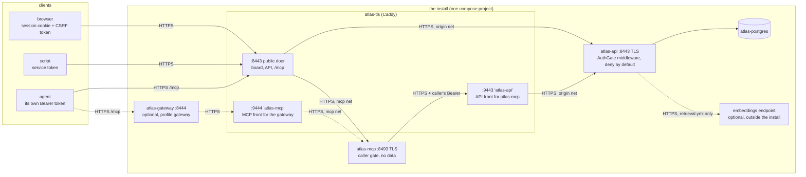

# Architecture

This page covers the parts of an Atlas install, how a request travels through them, where the
security boundaries are and where data is stored. It describes the install in `deploy/oss/`. Read
[Concepts](guides/concepts.md) first if the words *node*, *workitem* or *intent* are new to you.

Each section ends with the decisions it rests on and the reasons for them. The
[architecture decision records](README.md#architecture-decisions) record the same decisions with
the alternatives that were considered.

## The services

An install is one compose project (`deploy/oss/docker-compose.yml`) on one host. Five services run
by default, and two more are optional.

| Service | What it is | Published port | Networks |
|---|---|---|---|
| `atlas-postgres` | PostgreSQL 16 with the pgvector extension available. Holds all of Atlas's data. | none | `data` |
| `atlas-migrate` | A one-shot container that runs `atlas-migrate upgrade` to create or update the schema, then exits. `atlas-api` starts only after it succeeds. | none | `data` |
| `atlas-api` | One FastAPI process. It serves the JSON API under `/api`, the board at `/board`, the sign-in pages under `/auth` and the handbook at `/docs`. It listens on HTTPS `:8443` inside the stack, with its own certificate, and serves no plain HTTP. | none | `data`, `origin` |
| `atlas-mcp` | The MCP (Model Context Protocol) server that agents connect to, at `/mcp/`. It stores nothing. Each tool call becomes an API call made with the agent's own token. It listens on HTTPS `:8493` inside the stack, with its own certificate, and serves no plain HTTP. | none | `mcp` |
| `atlas-tls` | The TLS ingress, a Caddy server. It is the only service that publishes a port by default. | `443` (configurable) | `edge`, `origin`, `mcp`, `gateway` |
| `atlas-gateway` *(optional, profile `gateway`)* | An MCP gateway (AgentGateway) in front of `atlas-mcp`. Use it when you want one MCP address for several MCP servers, with a list of the tools each one exposes. | `8444` (configurable), TLS | `gateway`, `gateway-edge` |
| retrieval add-on *(optional)* | Semantic search alongside keyword search. It is **not a separate service**: it runs inside `atlas-api` when `ATLAS_RETRIEVAL=on`, and the `retrieval.yml` overlay gives `atlas-api` its one route out to an embeddings endpoint. The `atlas-retrieval` profile adds only a one-shot check of that configuration. | none | `egress` |

No model and no embedding service ship with Atlas. The retrieval add-on calls an
OpenAI-compatible embeddings endpoint that you choose, either a hosted one or a model you run on
another machine over TLS.

The two command-line tools ship in the `atlas-api` image. `atlas-admin` manages people, agents and
tokens. `atlas-migrate` manages the schema.

### The networks

Compose networks are what keep the services apart. Most of them are `internal`, which means they
have no route out of the host, and each one connects only the services that need to reach each
other.

| Network | Members | Internal | Purpose |
|---|---|---|---|
| `data` | postgres, migrate, api | yes | the database, with no route out |
| `origin` | api, tls | yes | the ingress reaching the API's TLS listener (`atlas-api-origin:8443`). Its subnet is pinned so that `ATLAS_TRUSTED_PROXY_CIDRS` is correct by construction. |
| `mcp` | mcp, tls | yes | the ingress reaching the MCP's TLS listener (`atlas-mcp-origin:8493`). On this network `atlas-tls` also answers to the name `atlas-api` (see the TLS hops below). |
| `gateway` | gateway, tls | yes | the gateway reaching `atlas-mcp` through `atlas-tls`, which answers here to the name `atlas-mcp` |
| `edge` | tls | no | the published port, plus ACME traffic when certificates are issued that way |
| `gateway-edge` | gateway | no | the gateway's published port |
| `egress` | api *(with `retrieval.yml` or `oidc.yml`)*, the retrieval check | no | the route to an embeddings endpoint or the identity provider |

`atlas-api` and `atlas-mcp` share no network. The MCP server has no plain-HTTP path to the API at
all, so the only way it can reach the API is through TLS.

In the base install, `atlas-api` sits only on internal networks, so it has no route out of the
host. Any feature that makes it call an outside service needs that route added on purpose. The
`retrieval.yml` overlay does this for the embeddings endpoint, and the `oidc.yml` overlay for the
identity provider that OIDC single sign-on needs `atlas-api` to reach; both join `atlas-api` to
`egress`.

**Decisions**

- **One ingress, one published port.** Every other service publishes nothing, and CI enforces
  this (`tools/ci/check_tls.sh` rule R5 forbids publishing a plain-HTTP port that carries
  tokens). Everything that faces the network is TLS and passes through one place, where the
  security headers are set.
- **Separate services for the API and the MCP server.** The MCP server is a thin facade that
  holds no data or logic of its own and has no credential of its own. Keeping it separate means
  the graph and its rules exist in exactly one place, the API, and the MCP layer can never become
  a second, weaker copy of them.
- **Retrieval runs inside the API, and Atlas is complete without it.** When the add-on is off,
  nothing of it runs and the schema is exactly what it would be without it. When it is on but
  misconfigured, it reports `unavailable: <reason>` on `/api/health` and never stops Atlas from
  starting. Search falls back to keyword search.

## How a request travels

### An agent's tool call, step by step

1. **Agent → gateway** *(optional)*. The agent connects over HTTPS to
   `https://<host>:<gateway port>/mcp` and sends `Authorization: Bearer <its own token>`. The
   gateway forwards that header unchanged to `atlas-mcp`. It keeps tool names exactly as the
   server defines them (`atlas_get`, never `atlas_atlas_get`). It allows CORS (cross-origin
   requests from a web page) from the install's own URL only, never from `*`.
   Without the gateway, the agent connects to `https://<host>/mcp/` on the main door instead.
2. **Gateway → MCP.** The gateway reaches `https://atlas-mcp:9444/mcp/`. That name is
   `atlas-tls`, whose certificate the gateway checks against the install CA. `atlas-tls` then
   forwards over HTTPS to `atlas-mcp-origin:8493` on the internal `mcp` network, checking
   `atlas-mcp`'s own certificate against the origin CA.
3. **MCP caller gate.** Before the MCP library sees the request, `mcp/app/caller_auth.py` checks
   it. A request with no token or an invalid token gets a `401` with a `WWW-Authenticate: Bearer`
   challenge, and no MCP session is created. The gate does not decide on its own: it asks the API
   (`GET /api/me`) with the caller's token. It caches a positive answer for a short time (60 s by
   default), keyed by a hash of the token. If the API cannot be reached, the answer is `503`, not
   a pass. The MCP server also checks the `Host` and `Origin` headers against
   `ATLAS_MCP_ALLOWED_HOSTS`/`_ORIGINS`, to block DNS rebinding.
4. **MCP → API.** The tool runs and calls `https://atlas-api:9443` with the **caller's** Bearer
   token (`mcp/app/client.py`). The MCP server holds no token of its own, and it refuses to send
   a request without a caller credential.
5. **API gate.** The request passes `AuthGate`, the middleware described below. On that internal
   name the gate admits only a Bearer request that carries no cookie.
6. **Route → database.** The route reads or writes Postgres. The caller's visibility filter is
   part of the SQL query itself, so a node the caller may not see is neither returned nor
   counted. Every graph write is recorded in `graph_event` by a single writer function, with the
   actor taken from the authenticated principal.
7. The answer returns along the same path. The MCP server wraps it in a fixed envelope
   (`{"ok": …, "result": …}`).

A browser takes the short path: public door → `atlas-api`. Its cookie never reaches the MCP
server, and the API's internal names never serve a cookie.

**Decisions**

- **Each agent calls as itself.** The caller's own token is forwarded at every hop, so the API
  applies that caller's scopes, grants and audit trail. A shared service identity would make
  the audit log say "atlas-mcp" for every call and would make one revocation cut off everyone.
- **The MCP server asks the API, and does not implement auth.** Its gate is the API's answer,
  asked once at the door, so that an unauthenticated caller gets a real `401` instead of a session
  in which every tool fails.

## The auth gate: middleware that fails closed

All authentication and authorization in `atlas-api` starts in one ASGI middleware, `AuthGate` in
`backend/auth.py`. It is installed right after the app is created
(`auth.install(app, …)` in `backend/main.py`).

**Why middleware, and not per-route dependencies.** FastAPI's route-level `Depends` does not see
mounted sub-applications or routes that have no dependency attached. A scheme built from those
**fails open**: the next route someone adds without the dependency is public. Middleware wraps
the whole application, including every mount, every 404 and every route added later, so a
forgotten check **fails closed**.

What the gate does, in order:

1. **Host allow-list.** A `Host` header that is not one of the install's origins (derived from
   `ATLAS_PUBLIC_URL`) gets `421 misdirected_request` before any handler or database work runs.
   This blocks host-header injection and DNS rebinding. The one exception is
   `ATLAS_INTERNAL_HOSTS`: an internal name such as `atlas-api:9443` is admitted, but only for a
   Bearer request that carries no cookie.
2. **One credential.** A request may carry `Authorization: Bearer …` (a machine or agent) or the
   `__Host-atlas_session` cookie (a person in a browser). If it carries both, it gets `400`.
3. **Resolve the principal.** Tokens are stored as keyed hashes (HMAC with a server-side pepper),
   and so are session ids. An invalid Bearer always gets `401`, and repeated failures from one
   address are rate limited. An expired cookie is treated as no credential.
4. **Deny by default.** A request without a principal is refused unless its path is on
   `PUBLIC_ROUTES`. That list is short: the landing page, sign-in, the privacy notice, the
   liveness probes, and `/docs` when `ATLAS_PUBLIC_DOCS=1`. A browser asking for HTML is
   redirected to sign in. Every other caller gets `401` JSON, because a script that follows a
   redirect would parse a login page as data and report success.
5. **Forced password change.** The flag is read from the database on every request, so a person
   who must change their password reaches only the change page.

After the gate, write routes call `auth.guard_write`. For a cookie session it checks the `Origin`
header and a CSRF synchronizer token (a per-session token that a forged cross-site request cannot
know). For a Bearer token it checks the token's scope (`read`, `write`, `admin`). A write route
with no scope entry fails closed.

**Failing closed at every level**

- If the gate itself raises an exception, the answer is `503`, never "let it through".
- Importing `auth` reads the required secrets (`ATLAS_TOKEN_PEPPER`, `ATLAS_PASSWORD_PEPPER`,
  `ATLAS_LOGIN_ORIGINS`) and raises **before the server binds its port** when one is missing.
  Nothing generates a value as a fallback, because a pepper that changed at every boot would log
  everyone out.
- At startup, if the gate cannot read its own tables, the startup sequence fails and the API does
  not serve.
- There is no setting that disables authentication, no default account and no self-registration.
  The first owner is created with `atlas-admin user add <name> --role owner`.
- `ATLAS_REQUIRE_SECRET_FILES=1` makes the services refuse a secret passed as a plain environment
  variable. Secrets are files, passed as compose `secrets:` and read through `*_FILE` settings.

## The TLS hops

Every hop that carries a token or a cookie is HTTPS with the certificate verified, the ingress's
own legs to its upstreams included. No service in the stack serves plain HTTP on any network:
`atlas-api` and `atlas-mcp` terminate TLS themselves on their one internal network, and nothing
listens on their old plain ports `8000` and `8092`.

| Hop | Protocol | Certificate checked against |
|---|---|---|
| client → `atlas-tls` public door (`:443` → `:8443`) | HTTPS | the install's certificate. Its source is `ATLAS_TLS_MODE`: `files` (from `init-certs.sh` or your own PKI), `internal` (Caddy's own CA) or `acme-cloudflare` (Let's Encrypt via DNS-01). |
| `atlas-tls` → `atlas-api` (`atlas-api-origin:8443`, `origin` network) | HTTPS | **only** `secrets/tls/origin-ca.crt`, under the name `atlas-api-origin`. `atlas-api` serves `api-origin.crt` from `init-certs.sh`. |
| `atlas-tls` → `atlas-mcp` (`atlas-mcp-origin:8493`, `mcp` network) | HTTPS | **only** `origin-ca.crt`, under the name `atlas-mcp-origin`. `atlas-mcp` serves `mcp-origin.crt`. |
| `atlas-mcp` → `atlas-tls :9443` (name `atlas-api`) | HTTPS | **only** the install CA (`ATLAS_CA_BUNDLE`). Optional mutual TLS (both sides present a certificate) with `ATLAS_TLS_CLIENT_AUTH=require`. |
| agent → `atlas-gateway` *(optional)* | HTTPS | the install's certificate |
| `atlas-gateway` → `atlas-tls :9444` (name `atlas-mcp`) | HTTPS | the install CA |
| `atlas-api` → embeddings endpoint *(optional)* | HTTPS | the system trust store, or `ATLAS_EMBED_CA_BUNDLE` |

`origin-ca.crt` is the install CA (a copy of `ca.crt`) on an install made by `init-certs.sh`. With
your own PKI, or on an install made before these listeners existed, `init-certs.sh --origin-only`
makes the two certificates under a separate CA that only the ingress trusts, so `ca.crt` and every
client stay as they are. Each service holds only its own key; neither sees the public door's.

`mcp/app/tls.py` enforces the MCP hop when the service starts. `ATLAS_BASE_URL` must be
`https://`, and the only exception is a loopback host, which never leaves the machine. Certificate
verification cannot be turned off. CI rejects a client built without verification
(`tools/ci/check_tls.sh` rule R4), an ingress upstream in the OSS Caddyfile that is not `https://`
with the origin-CA transport (rule R6), and an OSS compose file in which `atlas-api` or `atlas-mcp`
does not serve TLS itself (`tools/ci/check_oss_compose.py` rule S8). Install smoke leg 6 checks
every hop of the running install. The retrieval add-on applies the same rule to its endpoint.

Browser cookies are `Secure` and `__Host-`-prefixed, so a browser session cannot work over plain
HTTP at all. That is intended.

**Decision.** Atlas does not terminate the public TLS. It runs behind a TLS-terminating ingress,
and every internal hop that carries a token is re-encrypted, the ingress's own legs included: on
those, `atlas-api` and `atlas-mcp` terminate TLS with the install's internal certificates
([ADR 0005](adr/0005-gateway-behind.md)). The bundled ingress is one pinned Caddy
image. It has its admin API off, no plain-HTTP listener, and it sets the browser security headers
for every response in one place, including a Content-Security-Policy with no inline script. This
keeps the certificate handling out of the application, and an operator can swap in their own PKI
or certificate source without changing Atlas.

## Atlas behind any gateway

Atlas assumes something else sits at the edge, and it makes few assumptions about what that is.

**HTTP reverse proxies and load balancers.** The bundled `atlas-tls` is one option. You can put
your own reverse proxy, API gateway or load balancer in front of it, or replace it (it reads its
upstreams from `CADDY_API_UPSTREAM` and `CADDY_MCP_UPSTREAM`). Whatever sits in front must:

- terminate TLS for clients, because cookies are `Secure`;
- forward the `Host` header unchanged, or present a host that `ATLAS_PUBLIC_URL` names, because
  any other host gets `421`;
- forward `Authorization` unchanged;
- not buffer `/mcp/` responses, because MCP's streamable HTTP uses server-sent events;
- route every `/mcp/` request of one MCP session to the same `atlas-mcp` replica, because its
  sessions live in that process's memory; or set `ATLAS_MCP_STATELESS_HTTP=1` on `atlas-mcp`,
  which keeps no session, so any replica answers any request;
- set the real client address in `CF-Connecting-IP`, from an address range listed in
  `ATLAS_TRUSTED_PROXY_CIDRS`, so per-address sign-in throttling sees the client and not the
  proxy. Atlas ignores that header from anywhere else.

Atlas reads no identity headers from the proxy. It authenticates every request itself, so a proxy
cannot vouch for a caller, and a header a client forges has no effect.

**MCP gateways.** Any MCP gateway works as long as it passes the caller's `Authorization` header
through to `atlas-mcp`. The bundled one is AgentGateway (profile `gateway`, configured from
`deploy/gateway/gateway.yaml`). One limit applies to every gateway: **a gateway authorizes per
route, not per caller.** A tool federated through it is offered to every client of that route,
and only the API's token check tells callers apart. So the gateway configuration lists the tools
each server exposes (`tools:` in `deploy/gateway/gateway.yaml`). And `atlas-mcp`'s destructive
`atlas_delete` tool is not registered at all unless `ATLAS_MCP_ENABLE_DELETE` is set.

**Decision.** Atlas sits behind a gateway; it is not one. Identity, scopes and visibility are
enforced in the API on every call, so changing or adding a proxy or gateway cannot widen access.
The worst a misconfigured edge can do is refuse requests (`421`, `401`).

## Persistence

**Postgres is the only place Atlas keeps data.** That means nodes and edges, workitem prose,
acceptance criteria and results, node documents, intents, the `graph_event` history, the decision
records, accounts, sessions, tokens and the `auth_event` log. When the retrieval add-on is on,
its chunks and vectors are stored there too, in tables only the add-on creates. `atlas-api`,
`atlas-mcp` and the gateway keep no data of their own and can be restarted at any time. The
board is static files served from an explicit allow-list.

What an install stores on disk:

- the volume `atlas-pgdata`: the database;
- `deploy/oss/secrets/`: the database password and URL, the two peppers, the TLS material and any
  key files. These are written by `scripts/init-secrets.sh` and are never committed;
- the volumes `atlas-tls-data` and `atlas-tls-config`: certificates Caddy has issued, so that a
  recreated container keeps them.

**Back up the database and `secrets/` together.** The peppers are fixed for the life of the
install. Every password verifier and token digest is computed with them, so a database restored
without its peppers has no working password or token, and a new pepper invalidates all of them
at once.

**Starting up reads the graph; it does not import it.** Atlas reads no data from files at
startup. There is no markdown backlog and no manifest to sync. Startup creates the schema (see
below), seeds the `node_type` and `edge_type` registries (these define the vocabulary, not
content), and, **only into an empty graph**, writes what `ATLAS_SEED` asks for: `none` gives an
empty install with its own `atlas-system` handbook nodes, and `demo` adds one example project. A
second startup changes no row. The test suite proves this by taking a snapshot of the graph,
running startup again and comparing.

## Migrations

The schema is managed by SQLAlchemy models plus a small additive reconciler, not by a migration
framework.

- **`atlas-migrate upgrade`** (`backend/migrate_cli.py`) runs the schema half of startup and
  exits. It runs `create_all` for every model base (this creates missing tables), then
  `_reconcile_graph_schema` (this adds missing nullable columns and missing indexes to tables
  that already exist), then the full-text search indexes. It is idempotent and changes no data.
  In `deploy/oss` it runs as the `atlas-migrate` one-shot before `atlas-api` starts, and you can
  run it by hand after pulling a new release.
- **`atlas-api` startup** runs the same steps again, then the row-writing parts: registry
  seeding, the seed profile and the task-id sequence. Startup retries while Postgres comes up, and
  fails if the schema step fails.
- **One at a time.** Startup and `atlas-migrate upgrade` both hold a Postgres advisory lock
  (`main.boot_lock`) for their whole run, so several `atlas-api` replicas starting together, or
  a replica and the migrate command, never reconcile or seed at the same time: the next one waits,
  then finds nothing to add. A single process never waits. The retrieval add-on takes a different
  lock of its own.
- **Anything the reconciler cannot do** is a one-time script, `backend/migrate_*.py`. The
  reconciler cannot add a `NOT NULL` column, add a `CHECK` to an existing table, change a type,
  rename, drop or transform data. These scripts run in dry-run mode unless you pass `--apply`,
  and a destructive one refuses a table that has rows unless you also pass `--force`. Nothing
  destructive ever runs because a container restarted.

**Decision, and its limit.** Every schema change so far has been a new table or a new nullable
column. The reconciler handles those with no deploy step, so a full migration framework such as
Alembic was considered and deferred. The cost is that the reconciler only ever **adds**. If you
remove or retype a column in a model, the live table keeps the old one and nothing reports the
mismatch, so that change needs a written migration script. Revisit the decision when changes the
reconciler cannot make stop being one-offs.

## Where to read the code

| Path | What |
|---|---|
| `backend/main.py` | the app, the order middleware is installed in, startup, and the router table |
| `backend/auth.py` | the gate, sessions, service tokens, scopes and CSRF. Its header comment is the design. |
| `backend/routers/` | the routes, one module per area |
| `backend/migrate_cli.py` | `atlas-migrate` |
| `backend/retrieval/` | the retrieval add-on |
| `mcp/app/` | `atlas-mcp`: `caller_auth.py` (the caller gate), `client.py` (the API client), `tls.py` (the TLS rules for its outbound hop), `tools_*.py` (the tools) |
| `deploy/oss/` | the compose file, the `retrieval.yml` overlay, `caddy/Caddyfile` and `.env.example` |
| `deploy/gateway/` | the gateway configuration that `scripts/render-gateway.py` renders |
