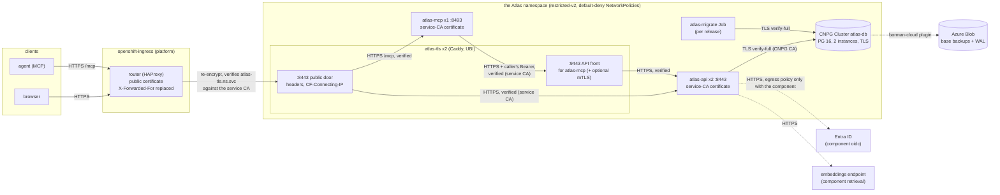

# Research: Atlas on Azure Red Hat OpenShift

This page is a design proposal, not a guide. It answers how Atlas should run on Azure Red Hat
OpenShift (ARO), question by question, and proposes the stories and tasks that would build it.
**Nothing here is implemented yet, and nothing is filed until the design is approved.** The
install that exists today is the Compose one in [Install](../INSTALL.md); it stays exactly as it
is.

It was written on 2026-11-05 for TASK-1475 (epic `EPIC-atlas-openshift-aro`). Statements about
Atlas come from the code, with `file:line` references at the commit this page was written against.
Statements about OpenShift, CloudNativePG and the other tools come from their primary sources,
listed in [Sources](#sources) and marked **unverified** where a primary page could not confirm
them. Versions are the ones current on that date: ARO installs OpenShift 4.20 and 4.21 (4.22 is
announced), CloudNativePG is at 1.30.1.

## The brief

Run the full stack (`atlas-migrate`, `atlas-api`, `atlas-mcp` and the TLS ingress) as
OpenShift-native resources in **one namespace**, with the database in a new CloudNativePG
`Cluster` on the organisation's existing CNPG operator. The constraints:

- **Namespace-scoped rights only.** No CRDs, ClusterRoles, custom SCCs or operators installed by
  us. Creating a `Cluster` (and its backup resources) on the existing operator is allowed.
- **The default `restricted-v2` SCC**: an arbitrary UID in group 0, no capabilities, no
  privileged ports.
- **Secrets as files only** (`ATLAS_REQUIRE_SECRET_FILES=1`).
- **TLS on every hop that carries a token**, verified; authentication fails closed.
- **Additive only**: a new deploy directory and new Dockerfile targets. The Compose install and
  the homelab do not change.
- UBI-based images, deployment from GitLab CI on the organisation's side, local tooling that works
  from PowerShell, and security and auditability first: the operator is a regulated organisation
  (an insurer).

## The recommendations in one table

| # | Question | Recommendation | The main reason |
|---|---|---|---|
| 1 | Base image | New `hardened-ubi` targets on `ubi9/python-312-minimal`, and a UBI build of Caddy on `ubi9-micro`; published as separate `-ubi` images | the same Python 3.12.15 and the same hashed lock install unchanged; 66 MB compressed against 43 MB today; the Debian images stay as they are |
| 2 | Packaging | Kustomize: `base/`, opt-in `components/`, the company's own overlay | `oc` has it built in, Argo CD reads it natively, and what is reviewed is what is applied |
| 3 | Ingress and TLS | A **re-encrypt Route to Caddy** (kept as `atlas-tls`), Caddy re-encrypting to `atlas-api` and `atlas-mcp`; every origin certificate from the **OpenShift service CA** | it is the only layout that keeps the real client address, the security headers, the `:9443` front for `atlas-mcp` and the optional mTLS leg without a code change |
| 4 | CloudNativePG | A 2-instance PG 16 `Cluster` on the `standard` image; Barman Cloud plugin backups to Azure Blob; `verify-full` with only the CNPG CA's `ca.crt`; the CNPG app Secret's `fqdn-uri` used as is | Atlas already accepts `postgresql://` (the assumed scheme gap does not exist), and libpq takes the TLS settings from `PGSSLMODE` / `PGSSLROOTCERT` |
| 5 | Migration | A Job per release, run by the pipeline after an on-demand backup; plus an advisory lock in startup (a small code change) | replicas starting together converge today only by retry |
| 6 | NetworkPolicies | Default deny, then one allow per compose network edge; router admitted by the `policy-group.network.openshift.io/ingress` label | reproduces the compose isolation, including "`atlas-mcp` cannot reach Postgres" |
| 7 | Secrets | Azure Key Vault as the source of truth, delivered by the Red Hat External Secrets Operator if the platform runs it, else plain Secrets made by a script; every one mounted as a file | the peppers need an audited, backed-up home outside the cluster |
| 8 | Configuration | One ConfigMap for `.env`, fixed values on the containers; `ATLAS_TRUSTED_PROXY_CIDRS` = the pod network, narrowed by NetworkPolicy | pod addresses are not fixed; who can connect is what makes the trust narrow |
| 9 | Probes and resources | HTTPS `httpGet` probes with the public Host header; 2 × api, 2 × tls, 1 × mcp; about 1.75 CPU and 2.9 GiB requested in all | measured peaks, with headroom; probes must pass the Host allow-list |
| 10 | Gateway | Out of v1 | not UBI, needs its own door, and the root requirement disappears anyway on OpenShift |
| 11 | CI | Upstream (GitHub Actions): image builds, manifest lint, a kind smoke under Pod Security `restricted`. Company (GitLab CI): mirror, verify, deploy. OpenShift Local by hand | OpenShift Local does not run on hosted runners; kind proves most of what matters |
| 12 | Audit and operations | Atlas's own audit tables plus the platform's logs; attested images; a scripted upgrade with a backup first; rollback by image digest | additive schema makes rollback an image change |


## What the code says

These are the facts about Atlas that the recommendations rest on, each read from the code at the
commit this page was written against. Several of them change the plan the task assumed.

| # | Fact | Where | Consequence on OpenShift |
|---|---|---|---|
| F1 | The client address is taken from `CF-Connecting-IP`, and only when the socket peer is inside `ATLAS_TRUSTED_PROXY_CIDRS`. `X-Forwarded-For` is never read. | `backend/passwords.py:1092-1129`, called from `backend/auth.py:902-911` | The OpenShift router sets `X-Forwarded-For`, not `CF-Connecting-IP`. With the router talking to `atlas-api` directly, every request would count against the router's own address and the per-address sign-in throttle would become one global bucket per router pod. Something must turn the router's header into `CF-Connecting-IP`, or the code must learn a second header. |
| F2 | `ATLAS_TRUSTED_PROXY_CIDRS` is a comma list; each entry goes through `ipaddress.ip_network(..., strict=False)`, so several CIDRs of any width are accepted. An entry that does not parse is skipped and logged as an error, not fatal. | `backend/settings.py:1603-1625`, `backend/passwords.py:1081-1089` | The pod network CIDR is a valid value. A typo silently trusts nothing, which fails safe (the throttle sees the proxy address) but must be caught by a deploy check. |
| F3 | `ATLAS_DB_URL` goes straight into `create_engine()` with no scheme check. SQLAlchemy's default driver for `postgresql://` is psycopg2, the driver the image ships. | `backend/db.py:130-142`; backup code parses the URL with `make_url` only (`backend/crunch_backup.py:152-194`, `backend/backup_restore.py:164-416`) | **The task's assumption is wrong:** a `postgresql://` URL already works. No bridge and no code change are needed for the scheme. What CNPG's generated URL lacks is `sslmode` and `sslrootcert`; see [question 4](#question-4-cloudnativepg). |
| F4 | `atlas-migrate upgrade` and every `atlas-api` boot run the same schema steps (`create_all`, then `_reconcile_graph_schema`, then the search indexes). The reconcile inspects the catalogue and then issues `ALTER TABLE ... ADD COLUMN` / `CREATE INDEX`; nothing takes a lock. Boot then writes rows on every start (the node and edge type registries are upserted; the system node set is inserted into an empty graph). | `backend/migrate_cli.py:113-130`, `backend/main.py:60-155`, `backend/main.py:158-262`, `backend/node_types.py:122-135`, `backend/system_node.py:95` | Two replicas starting at once can both decide a column or row is missing; the loser gets a duplicate-object or unique-key error. Startup catches every exception and retries up to 30 times, 2 s apart (`backend/main.py:84-155`), so the pair converges, but by retry, not by design. A Job that runs first removes the DDL race; the row-seeding race on an empty database remains. |
| F5 | The retrieval add-on's background reconciler takes `pg_try_advisory_lock` per pass, so a second process skips the round. | `backend/retrieval/reconciler.py:5-6, 195-238` | Safe with several `atlas-api` replicas. (This is the only "reconciler" in the code that is concurrency-safe by design; the schema reconcile in F4 is not.) |
| F6 | `atlas-mcp` uses stateful Streamable HTTP sessions (FastMCP with a 4-hour idle timeout, no `stateless_http`). | `mcp/app/mcp_server.py:70, 101-106`, `mcp/app/main.py:39` | With two or more `atlas-mcp` replicas, a request carrying `Mcp-Session-Id` that lands on the other pod is refused and the client must start a new session. One replica, or a code change to an opt-in stateless mode, is needed. |
| F7 | The per-address failure limiter is in process memory. | `backend/passwords.py:956-974` | With N `atlas-api` replicas the per-address ceiling is effectively N times higher. The per-account backoff, the primary control, is in the database (`auth_login_throttle`, `backend/models_auth.py:423`) and is shared. Sessions and OIDC login flows are database rows too (`auth_session`, `auth_login_flow`: `backend/models_auth.py:360`, `backend/identity/flows.py:52`), so any replica can serve any request. |
| F8 | `/healthz` (no database) and `/readyz` (one `SELECT 1`) exist for probes, but the Host allow-list runs before them: a Host the API does not serve gets 421. `atlas-mcp`'s `/health` is outside the MCP transport's Host check. | `backend/auth.py:2095-2119`, `backend/auth.py:1249-1260`, `mcp/app/main.py:46-56` | Kubelet probes on `atlas-api` must send `Host: <ATLAS_PUBLIC_HOST>`; `atlas-mcp`'s need nothing special. |
| F9 | `ATLAS_INTERNAL_HOSTS` matches a Host header exactly, or by name when the entry has no port. | `backend/settings.py:324-329, 367-372` | On OpenShift it names the Service DNS name the MCP server dials, with the port. |
| F10 | `atlas-mcp` refuses a non-HTTPS `ATLAS_BASE_URL` (loopback excepted) and, with `ATLAS_CA_BUNDLE` set, trusts only that file. | `mcp/app/tls.py:1-80` | The OpenShift service CA bundle, injected into a ConfigMap, is a valid `ATLAS_CA_BUNDLE`. |
| F11 | Every browser security header (CSP, HSTS, `X-Frame-Options`, `Referrer-Policy`, `X-Content-Type-Options`) is set by Caddy, not by Atlas, and Caddy strips four Cloudflare Access headers. `tools/ci/check_oss_headers.py` checks the Caddyfile statically. | `deploy/oss/caddy/Caddyfile:59-112` | Dropping Caddy means re-creating all of this on the Route, and losing the static check. |
| F12 | The hardened images' `HEALTHCHECK` probes plain HTTP `:8000`/`:8092`, which the TLS layout does not serve; the compose file overrides it. | `backend/Dockerfile:192-193`, `mcp/Dockerfile:274-275`, `deploy/oss/docker-compose.yml:206-211, 242-247` | CRI-O ignores Docker `HEALTHCHECK`; Kubernetes probes replace it. No change needed. |
| F13 | `ATLAS_CERT_EXPIRY_FILE` watches the public server certificate, mounted read-only into `atlas-api`. | `deploy/oss/docker-compose.yml:179-187`, `backend/cert_expiry.py` | When the router holds the public certificate, the pod does not have it. |
| F14 | The CI gates `tools/ci/check_binds.sh` and `tools/ci/check_tls.sh` (rule "publishes") scan every `deploy/**/*.y*ml` for `ports:` lists, and reject a list item of the form `key: value` as "long-syntax". `tools/ci/check_pins.py` checks only YAML files with a top-level `services:` key. | `tools/ci/check_binds.sh:41-58, 153`, `tools/ci/check_tls.sh:214-218`, `tools/ci/check_pins.py:20-25, 303-305` | A Kubernetes manifest under `deploy/openshift/` fails `check_binds.sh` on its first `ports:` list, and its `image:` lines are not pin-checked at all. Both gates need a small change before the first manifest lands. |
| F15 | The bundled-Postgres secret `db_password` exists only for the postgres image's first `initdb`; `atlas-api` reads only `ATLAS_DB_URL_FILE`. | `deploy/oss/docker-compose.yml:122-129`, `backend/db.py:130-142` | Dropped on OpenShift: CNPG creates the role and its password. |

## Where the code contradicts the brief

Three assumptions in the task do not hold, and one gap was not in it:

1. **The DSN scheme is not a problem (F3).** `postgresql://` already works; no bridge is needed.
2. **The "reconciler" is not one thing.** The retrieval reconciler is concurrency-safe by design
   (F5); the schema reconcile at boot is not (F4).
3. **The OpenShift router cannot stand in for Caddy without a code change (F1, F11).** Atlas
   reads only `CF-Connecting-IP`, and the router can neither set that header from the client
   address (`%[src]` is not an allowed dynamic value in Route header actions) nor set HSTS through
   them.
4. **Not in the brief: the repository's own CI gates break on Kubernetes YAML (F14).** Task 3.0
   fixes that before the first manifest.

## Target architecture



Every arrow that carries a token or a session cookie is TLS with the certificate verified, as in
Compose. What changes is who issues the certificates (the router's certificate for the public
door, the service CA for every hop inside the namespace) and what keeps the hops apart
(NetworkPolicies instead of compose networks).


## The twelve questions

### Question 1. Base image

**Recommendation: a new `hardened-ubi` stage in `backend/Dockerfile` and in `mcp/Dockerfile`,
`FROM registry.access.redhat.com/ubi9/python-312-minimal` pinned by digest, placed before the
final unnamed stage (which must stay last and empty). It copies `/app` from the existing `base`
stage and installs the same hashed lock. A UBI build of the Caddy front (`deploy/caddy/
Dockerfile.ubi`): xcaddy on `ubi9/go-toolset`, the static binary on `ubi9/ubi-micro`. The three
are published as new images, `gradinai-atlas-{api,mcp,tls}-ubi`; the existing images, their
names and their gates do not change.**

Measured on 2026-11-05 (`linux/amd64`, compressed = registry size, uncompressed = exported root
filesystem):

| Image | Compressed | Uncompressed | Python | Notes |
|---|---|---|---|---|
| `python:3.12-slim` (today) | 43.3 MB | 119.9 MB | 3.12.15 | Debian trixie, runs as root until the hardened stage |
| `ubi9/python-312-minimal` (proposed) | 66.0 MB | 175.7 MB | 3.12.15 | RHEL 9.8, glibc 2.34, default user 1001 in group 0 |
| `ubi10/python-312-minimal` | 60.7 MB | 158.0 MB | 3.12.15 | RHEL 10.2, glibc 2.39 |
| `ubi9/python-312` (full s2i) | 397.6 MB | 1013.8 MB | 3.12 | carries Node.js and the s2i tooling: rejected |
| `ubi9/ubi-micro` (Caddy runtime) | 7.3 MB | 23.6 MB | none | no package manager, no CA bundle |
| `caddy:2.11.7` (today) | 24.9 MB | 66.7 MB | none | Alpine |

Answers to the sub-questions:

- **Size.** About 23 MB more per Python image compressed (+53%). The Caddy image gets smaller.
- **CVE posture.** Not measured in this research: the comparison needs the built images, and task
  1.1 gets it from the same Trivy gate (`tools/ci/sca_gate.py`) the current images pass. Two
  things are known. Red Hat rebuilds UBI images when errata ship and grades each one with the
  Container Health Index (grade A: no unapplied Critical or Important errata). And Trivy reports
  RHEL packages with Red Hat's own fix status, so "fixable" means "Red Hat has shipped a fix", a
  stricter and slower notion than Debian's for some packages. **Unverified** which way the
  finding count goes.
- **Wheels.** Every compiled dependency has a manylinux wheel that UBI 9's glibc 2.34 satisfies
  (psycopg2-binary `manylinux_2_17`, argon2-cffi-bindings `manylinux_2_28`, cryptography
  `manylinux_2_17/2_28/2_34`, uvloop and httptools `manylinux_2_28`). A throwaway
  `pip install --only-binary=:all:` on both UBI minimal images installed and imported all of them
  and computed an argon2id hash. The lock already carries every platform's hash
  (`backend/requirements-lock.txt` lists, for example, all psycopg2-binary wheels), so
  `--require-hashes` works unchanged. Nothing compiles, so the runtime image needs no compiler.
- **The FIPS question, which the brief does not ask but an insurer will.** ARO can be created in
  FIPS mode (`az aro create --fips`, at creation only), and then every workload is expected to use
  FIPS-validated cryptography. Neither the psycopg2-binary wheel (its own libpq 17 and OpenSSL)
  nor the cryptography wheel (OpenSSL 4.0 statically linked) uses the RHEL FIPS-validated
  OpenSSL; psycopg's own documentation recommends the source build for production. If the cluster
  is FIPS, a further variant is needed that builds psycopg2 (not `-binary`) against the system
  libpq and cryptography against the system OpenSSL, and Caddy with CGO and the RHEL Go FIPS
  toolchain. That is task 1.6, conditional on the answer (open question 2).
- **UBI 9 or UBI 10.** The brief says UBI 9, and that is the recommendation: ARO's nodes run RHEL
  9-based RHCOS, and Red Hat's own Python 3.12 builds for UBI 9 are current. UBI 10 is GA, has
  Python 3.12 as its system Python for its whole life, and is supported longer (maintenance to
  2035 against 2032, **unverified** exact dates). The stage takes the base as a build argument, so
  moving is a one-line change later.
- **Red Hat certification.** Not worth pursuing for an open-source project consumed internally:
  it needs a Partner Connect account and a submission per release. The checks themselves are
  useful, and `preflight check container` runs locally with no account. The `-ubi` images should
  pass it: a UBI base, the labels `name`, `vendor`, `version`, `release`, `summary`,
  `description` and `maintainer`, a `/licenses` directory (no UBI image has one; the stage copies
  `LICENSE` and `NOTICE` there), a non-root user, no modified Red Hat files, at most 40 layers.
  Task 1.4 runs preflight as a lint.
- **GHCR, SBOM, SCA and pinned digests.** Additive: three more images in `images.yml`'s
  `build-scan` and `publish` jobs and in `sbom-sca.yml`, under new names, so a Compose install's
  `ATLAS_IMAGE_*` lines mean what they meant. The `FROM` lines are tag@digest like every other
  (`tools/ci/check_pins.py`), and Dependabot's docker ecosystem already watches `/backend` and
  `/mcp` (the Dockerfile header says so), so it bumps the UBI bases too. A UBI image is rebuilt by
  Red Hat more often than the Debian one, so these bumps will be more frequent.
- **Caddy.** There is no official UBI Caddy image. Caddy 2.11 needs Go 1.26, and
  `ubi9/go-toolset` carries Go 1.26.10, so `CGO_ENABLED=0 xcaddy build` there works; the binary
  runs on `ubi-micro`. The Cloudflare DNS plugin is left out of the UBI build: on OpenShift there
  is no ACME. Caddy needs `XDG_DATA_HOME` and `XDG_CONFIG_HOME` writable (an `emptyDir` each), and
  listens on 8443 and 9443 (no low port). `ubi-micro` has no CA bundle, which is fine: every
  upstream Caddy dials is verified against a mounted CA file. Caddy 2.11.9 was released on the day
  of writing; the build pins whichever is current when task 1.3 runs.


### Question 2. Packaging

**Recommendation: Kustomize. A `base/` with the always-on parts, `components/` for each opt-in
feature (`cnpg`, `oidc`, `retrieval`, `mtls`, `external-secrets`, `gitops`), and one example
overlay. The company keeps its own overlay in its own GitLab repository, pointing at the upstream
base by release tag. No Helm chart in v1.**

Why:

- **Nothing extra to install or trust.** `oc apply -k` and `kubectl apply -k` have Kustomize built
  in, so the GitLab runner needs only `oc`. OpenShift GitOps (Argo CD) renders a Kustomize
  directory natively, with no plugin.
- **What is reviewed is what is applied.** The manifests are plain YAML; an auditor reads them
  without knowing a template language, and `kustomize build` prints the exact objects. With Helm,
  the reviewed artefact is a template plus values, and the applied objects exist only after
  rendering.
- **The repository's own pattern is overlays.** The Compose install is a base file plus opt-in
  overlays (`external-db.yml`, `oidc.yml`, `retrieval.yml`); Kustomize components are the same
  idea, so each compose overlay has one named counterpart.
- **Per-environment configuration** lives in the company overlay: the namespace, the public
  host, the image digests (`images:`), the `atlas-env` ConfigMap generator, resource patches, and
  which components are on. Secrets are never in it (question 7).
- **Helm's one advantage, hooks, does not fit here.** A migration hook would tie the schema
  upgrade to `helm upgrade`; Argo CD runs only part of Helm's hook model and maps it onto its own,
  so the behaviour would differ between the two deploy paths. The Job with a release name (question 5)
  behaves the same under `oc` and under Argo CD (with the `gitops` component adding the `PreSync`
  annotation).
- A Helm chart can be generated from the same base later if another consumer asks for one; it is
  additive and not needed now.

Two caveats for the pipeline: `oc apply -k` does not delete an object that was removed from the
manifests (pruning needs `--prune` with a label selector, and the label must be on everything we
own and nothing else), and a Job is replaced by name, not updated (question 5).

### Question 3. Ingress and TLS

**Recommendation: keep Caddy, as the `atlas-tls` Deployment, behind a re-encrypt Route. The
router terminates the public TLS with the platform's certificate and re-encrypts to Caddy;
Caddy re-encrypts to `atlas-api` and `atlas-mcp` exactly as in Compose. Every certificate inside
the namespace comes from the OpenShift service CA. `atlas-mcp` keeps reaching the API only
through Caddy's `:9443` front.**

The three layouts compared:

| | Passthrough Route → Caddy | **Re-encrypt Route → Caddy** | Re-encrypt Route → api / mcp directly |
|---|---|---|---|
| Real client address for the sign-in throttle | **lost**: the router passes TCP, Caddy sees a router pod; PROXY protocol cannot be enabled for the `LoadBalancerService` strategy on Azure, and the IngressController is cluster-scoped anyway | kept: the router sets `X-Forwarded-For`, Caddy turns it into `CF-Connecting-IP` | needs a code change (F1): Atlas never reads `X-Forwarded-For`, and the Route cannot set `CF-Connecting-IP` (`%[src]` is not an allowed dynamic value) |
| Security headers (CSP, HSTS, frame, referrer) | kept in Caddy | kept in Caddy, with `tools/ci/check_oss_headers.py` | CSP and the others as Route response actions; HSTS only through the `haproxy.router.openshift.io/hsts_header` annotation; the static header check is lost |
| Public certificate | ours, in a Secret, renewed by us | the router's (platform PKI or the default wildcard) | the router's |
| `atlas-mcp` → API hop, and optional mTLS | unchanged | unchanged | `atlas-mcp` dials `atlas-api` directly; mTLS lost (it would apply to the router's connections too) |
| Code changes | none | none | client-address header, and `ATLAS_INTERNAL_HOSTS` |

Re-encrypt to Caddy wins on every row that matters for this install, at the cost of one extra
hop and a third image.

**The hops, each verified:**

| Hop | TLS | Certificate and name checked |
|---|---|---|
| client → router | the router's public certificate | by the client |
| router → `atlas-tls:8443` | re-encrypt; `destinationCACertificate` **left empty** | the router verifies the service-CA certificate **and its name** `atlas-tls.<ns>.svc`. (With a `destinationCACertificate` set, the router checks the chain but not the name, so leave it empty.) The router sends **no SNI** on this leg, so the OpenShift Caddyfile sets `default_sni atlas-tls.<ns>.svc` |
| `atlas-tls` → `atlas-api:8443` | Caddy's `origin_tls` snippet as today | trust pool: the injected service-CA bundle; `tls_server_name atlas-api.<ns>.svc` |
| `atlas-tls` → `atlas-mcp:8493` | as above | `atlas-mcp.<ns>.svc` |
| `atlas-mcp` → `atlas-tls:9443` → `atlas-api` | `ATLAS_BASE_URL=https://atlas-tls.<ns>.svc:9443` | `atlas-mcp` trusts only the service-CA bundle (`ATLAS_CA_BUNDLE`, F10) |

**The client address.** The Route carries `haproxy.router.openshift.io/set-forwarded-headers:
replace`, so the router overwrites `X-Forwarded-For` with the address it saw (`%[src]`) and a
client cannot prepend a forged one. The router's Service on ARO uses `externalTrafficPolicy:
Local`, so that address is the client's (**unverified** on an ARO page; to be checked on the
cluster with one login). Caddy believes the header only from the router: `servers {
trusted_proxies static <pod network CIDR> ; client_ip_headers X-Forwarded-For ;
trusted_proxies_strict }`, and the NetworkPolicy admits only the router's namespace to `:8443`.
Then `header_up CF-Connecting-IP {client_ip}` in place of `{remote_host}`, and Atlas is unchanged.
If the organisation puts an Application Gateway or Front Door in front of ARO, the router's
peer is that gateway: use `append` instead of `replace` and add the gateway's subnet to Caddy's
trusted proxies, so the rightmost untrusted address is the client (open question 5).

**The service CA instead of `init-certs.sh`: yes.** Annotating each Service with
`service.beta.openshift.io/serving-cert-secret-name` gives a `kubernetes.io/tls` Secret
(`tls.crt`, `tls.key`) for `<svc>.<ns>.svc`, valid two years and reissued automatically; a
ConfigMap annotated `service.beta.openshift.io/inject-cabundle: "true"` receives the CA bundle as
`service-ca.crt` (the operator owns that ConfigMap's data, so it gets one of its own). Both are
annotations on our own objects. It removes four Secrets and the whole origin-CA procedure from the
operator's hands. Two consequences:

- **Reissue needs a restart.** The service CA reissues a leaf only within its last hour, and
  rotates the CA when under 13 months remain (the old CA stays trusted until it expires).
  Neither uvicorn nor Caddy reloads a certificate file. Every deploy restarts the pods, and the
  company pipeline adds a scheduled `oc rollout restart` (weekly), which keeps every pod well
  inside its certificate's life.
- **The names change.** The service CA cannot add SANs such as the bare `atlas-api`, so the
  internal names become the Service FQDNs (the env table shows each).

**Internal TLS with NetworkPolicies or a mesh: still required.** Atlas's security model is that
every hop carrying a token is TLS, whatever the network (`deploy/oss/docker-compose.yml:37-44`,
enforced by `tools/ci/check_tls.sh`), and NetworkPolicy is a layer 3/4 control that says nothing
about who can read the traffic on a node or a misrouted packet. A service mesh's mTLS would be an
acceptable substitute only through a new ADR; if the organisation runs a mesh, the Atlas pods
either stay out of it or accept double encryption.

**Optional mTLS (`ATLAS_TLS_CLIENT_AUTH`).** Kept, as the `mtls` component. The service CA issues
server certificates only (its certificates carry `serverAuth` alone), so the client CA and
`atlas-mcp`'s client certificate come from the organisation's PKI, or from `init-certs.sh` as in
Compose, delivered as Secrets.

**The public certificate.** The router's, either the platform's default wildcard or a
certificate on the Route from the organisation's PKI (open question 4). `ATLAS_CERT_EXPIRY_FILE`
is set only when that certificate is in our namespace as a Secret; otherwise its expiry is the
platform team's to watch.

### Question 4. CloudNativePG

**Recommendation: a `Cluster` named `atlas-db` with two instances, PostgreSQL 16 on the
CloudNativePG `standard` image, database `atlas` owned by `atlas`, no superuser access; backups by
the Barman Cloud plugin to an Azure Blob container, 30 days' recovery window, a daily
`ScheduledBackup` and an on-demand `Backup` before every deploy; `atlas-api` connects with
`sslmode=verify-full` against the CNPG CA's `ca.crt` alone.**

An outline of the resource (the manifest itself is task 3.5):

```yaml
apiVersion: postgresql.cnpg.io/v1
kind: Cluster
metadata:
  name: atlas-db
spec:
  instances: 2
  imageName: ghcr.io/cloudnative-pg/postgresql:16.<minor>-standard-trixie@sha256:<digest>
  primaryUpdateStrategy: unsupervised
  primaryUpdateMethod: switchover
  bootstrap:
    initdb:
      database: atlas
      owner: atlas
      encoding: UTF8
  storage:    {size: 20Gi, storageClass: <from the platform team>}
  walStorage: {size: 5Gi,  storageClass: <from the platform team>}
  resources:
    requests: {cpu: 500m, memory: 1Gi}
    limits:   {cpu: "2", memory: 2Gi}
  affinity:
    enablePodAntiAffinity: true
    topologyKey: topology.kubernetes.io/zone
  plugins:
    - name: barman-cloud.cloudnative-pg.io
      isWALArchiver: true
      parameters: {barmanObjectName: atlas-backups}
```

- **Instances.** Two (a primary and a hot standby in another zone) is the smallest layout that
  survives a node or zone loss without a restore. Three if the platform team's standard says so.
- **The image.** PostgreSQL 16 is supported by CNPG 1.30 (it supports 14 to 18). Plain `16` tags
  are no longer published; the tag names the minor and the flavour, and the manifest pins the
  digest. If the platform team publishes an image catalog, `imageCatalogRef` with `major: 16`
  replaces `imageName`.
- **pgvector.** Only the retrieval add-on uses it (`docs/oss/guides/external-postgres.md`, and
  `ATLAS_EMBED_*` is off by default). It is in the `standard` image, not in `minimal`. pgvector is
  not a trusted extension, so the `atlas` owner cannot `CREATE EXTENSION vector` itself; the
  `retrieval` component adds a CNPG `Database` resource with `extensions: [{name: vector}]`, so the
  operator creates it. (CNPG's newer image-volume extensions need PostgreSQL 18 and do not apply.)
  Without the add-on the extension is never created, as in Compose.
- **Backup.** The in-tree `spec.backup.barmanObjectStore` is deprecated since CNPG 1.26 and
  removed in 1.32. The replacement, the Barman Cloud plugin, is installed **once per cluster, in
  the operator's namespace, with cert-manager, by the platform team**; its `ObjectStore` resource
  is namespaced and ours. If the platform team does not run the plugin, the fallback is the
  in-tree method with a filed task to move before the operator reaches 1.32 (open question 6).
  The `ObjectStore` points at `https://<account>.blob.core.windows.net/<container>/atlas`, with
  `retentionPolicy: "30d"` (a recovery window, so point-in-time recovery reaches back 30 days);
  credentials by Azure workload identity if the platform supports it for the plugin, else a SAS
  token scoped to that container in a Secret. The storage account should have soft delete and an
  immutability policy, which is the organisation's evidence that a backup cannot be altered.
- **Restore test.** A restore is always a new `Cluster` bootstrapped from the object store
  (`bootstrap.recovery`, optionally with a `recoveryTarget` time), never in place. The drill:
  quarterly, into a scratch namespace, restore the latest backup, start `atlas-api` against it
  with the production peppers, sign in with the break-glass account, compare node and edge counts
  with production (`tools/ci/oss_db_counts.sh` shows the queries). That one drill proves the
  database, the WAL archive and the peppers are recoverable together.
- **Client TLS with `verify-full`.** CNPG's server certificate names each service in four forms,
  `atlas-db-rw`, `atlas-db-rw.<ns>`, `atlas-db-rw.<ns>.svc` and the cluster-domain form, signed by
  the CA in the Secret `atlas-db-ca`. That Secret also holds `ca.key`: the pods project **only the
  `ca.crt` item** (a `secret` volume with `items`), mounted at `/run/secrets/db-ca/ca.crt`. CNPG's
  default `ssl_min_protocol_version` is TLS 1.3, which the bundled libpq 17 speaks.
- **The DSN.** CNPG's app Secret `atlas-db-app` has `uri`, `fqdn-uri`, `password` and the parts;
  `fqdn-uri` is `postgresql://atlas:<pw>@atlas-db-rw.<ns>.svc.<cluster domain>:5432/atlas`. Atlas
  accepts that scheme as it is (F3), so `ATLAS_DB_URL_FILE` points at the projected `fqdn-uri` key
  and no Secret of ours holds the password. None of CNPG's URIs carries `sslmode`; libpq reads
  `PGSSLMODE=verify-full` and `PGSSLROOTCERT=/run/secrets/db-ca/ca.crt` from the environment,
  which psycopg2 and `pg_dump` both honour, and those are not secrets. **No code change.** The
  other option, our own DSN Secret with the query string in it, would put the password in a
  second place and break when CNPG rotates it.
- **What the role cannot do.** The `atlas` owner has no `CREATEDB`, so `atlas-admin backup run`
  and `restore` (which make temporary databases) are not used on OpenShift; CNPG's backups replace
  them, and the crunch-week backup policy has no loop to act on it (the `atlas-backup` service is
  not deployed). That is a documented gap, not a defect: a crunch week on OpenShift relies on
  the WAL archive, which already gives point-in-time recovery to any second.
- **Namespace-scoped rule: it fits.** `Cluster`, `Backup`, `ScheduledBackup` and `Database` are
  namespaced resources of an operator someone else installed; OLM aggregates their roles into the
  namespace `admin` and `edit` roles. Two caveats for the platform team: the plugin's
  `ObjectStore` comes from the plugin, not OLM, so its role may need granting; and community
  CloudNativePG supports vanilla Kubernetes only, while on OpenShift the supported product is
  **EDB Postgres for Kubernetes**, whose API group is `postgresql.k8s.enterprisedb.io` and whose
  labels differ. The manifests target one group; which one is open question 6, and a kustomize
  component can switch it.

### Question 5. Migration

**Recommendation: a Kubernetes Job that runs `atlas-migrate upgrade` before the Deployments roll,
created by the pipeline with a name per release (`atlas-migrate-<version>`), waited on with
`oc wait --for=condition=complete`. Not an init container. A Helm hook does not apply (Kustomize,
question 2); an Argo CD `PreSync` hook annotation lives in an optional `gitops` component for a company
that deploys through Argo CD. Separately, task 2.1 adds a Postgres advisory lock around the boot
steps so that several `atlas-api` replicas starting together are safe by design, not by retry.**

Why:

- **What happens today with several replicas (F4).** Each `atlas-api` pod runs the whole schema
  path and the registry seeding at boot, with no lock. Two pods that start together can both
  decide a column, an index or a row is missing; one gets an error, and the startup loop retries it
  (30 attempts, 2 s apart, `backend/main.py:84-155`), by which time the other has committed. It
  converges, so it is not a correctness bug today, but it logs errors on every rollout of an
  upgrade and relies on a retry loop written for "Postgres is not up yet". On an **empty**
  database it also races the system-node seed. The Job removes the DDL half of the race (the pods
  find nothing to add); the advisory lock (task 2.1) removes the rest.
- **Why not an init container.** It runs once per pod, so with two replicas it is the same race
  moved earlier, and it re-runs on every pod restart and every node drain. A Job runs once per
  release and its success or failure is one object the pipeline and an auditor can read.
- **Why the Job fits GitLab CI.** A Job's pod template is immutable, so re-applying a changed Job
  fails. A name per release (`atlas-migrate-v0-4-0`) makes each run a new object, keeps the
  previous run's log for the audit trail until `ttlSecondsAfterFinished` removes it, and makes
  the pipeline step plain: apply, wait, fail the pipeline if the Job failed. Settings:
  `backoffLimit: 1`, `activeDeadlineSeconds: 600`, `ttlSecondsAfterFinished: 604800` (7 days),
  `restartPolicy: Never`.
- **The migrate Job must not load the sign-in settings.** It already drops them itself
  (`backend/migrate_cli.py:60-68`), so it can share the `atlas-env` ConfigMap; it gets the
  database URL, the CA and the peppers, and nothing else.
- **Ordering.** The pipeline takes a CNPG on-demand `Backup` first (question 4), then the Job, then
  `oc apply` of the Deployments and `oc rollout status`. Because every schema step is additive
  (`backend/main.py:158-262`: nullable `ADD COLUMN` and `CREATE INDEX` only), the old pods keep
  working against the new schema during the rolling update, and a rollback to the previous image
  needs no schema rollback.

### Question 6. NetworkPolicies

**Recommendation: one default-deny policy for the namespace (ingress and egress), then one allow
policy per edge below, selecting pods by `app.kubernetes.io/component`. Egress to the identity
provider and the embeddings endpoint comes only with the `oidc` and `retrieval` components.**

The seven compose networks become these edges:

| Compose network | Members | OpenShift policy |
|---|---|---|
| `data` | postgres, migrate, api | ingress to the CNPG pods (`cnpg.io/cluster: atlas-db`) on 5432 from `atlas-api` and the migrate Job only; the operator's own access to its instances must stay open (see below) |
| `origin` | api, tls | ingress to `atlas-api` on 8443 from `atlas-tls` pods only |
| `mcp` | mcp, tls | ingress to `atlas-mcp` on 8493 from `atlas-tls` only; ingress to `atlas-tls` on 9443 from `atlas-mcp` only |
| `edge` | tls | ingress to `atlas-tls` on 8443 from the router: `namespaceSelector: {matchLabels: {policy-group.network.openshift.io/ingress: ""}}` |
| `egress` | api (with an overlay) | egress from `atlas-api` on 443 to the IdP or the embeddings endpoint, only in the `oidc` / `retrieval` components. NetworkPolicy cannot name a host; it allows 443 to the CIDRs the platform team gives (or, if they run one, an egress proxy or EgressFirewall, which is theirs) |
| `gateway`, `gateway-edge` | gateway, tls | not in v1 (question 10) |

Plus, for every pod: egress to DNS, written as OpenShift's documentation writes it (a
`namespaceSelector` on `kubernetes.io/metadata.name: openshift-dns`, TCP and UDP **5353**, the DNS
pods' own port, not the service's 53), and egress from `atlas-api` and the Job to the
database on 5432, from `atlas-tls` to `atlas-api:8443` and `atlas-mcp:8493`, and from `atlas-mcp`
to `atlas-tls:9443`.

**`atlas-mcp` cannot reach Postgres** because nothing allows it: its egress policy names
`atlas-tls:9443` and DNS only, and the database's ingress names `atlas-api` and the Job only. Task
3.4's smoke proves the denial.

The CNPG operator runs in another namespace and talks to each instance's status port (8000) and
to Postgres, and the two instances replicate to each other on 5432. A default-deny ingress on our
namespace blocks all of that, so the database's allow policy admits the operator's namespace on
8000 and 5432 and the `atlas-db` pods to each other; the operator namespace is open question 6.

Kubelet probes come from the node, not a pod. Kubernetes states that traffic to and from a pod's
own node is always allowed under NetworkPolicy; that this holds for probes on OVN-Kubernetes is
not stated in OpenShift's documentation (**unverified**). If it does not, the documented allow is
a `namespaceSelector` on `policy-group.network.openshift.io/host-network: ""`. The OpenShift Local
run (task 6.3) settles it.


### Question 7. Secrets

**Recommendation: Azure Key Vault is the source of truth for every secret we create (the two
peppers, the OIDC credential, the embeddings key, the backup credential if it is a token). They
reach the namespace through the Red Hat-supported External Secrets Operator with a namespaced
`SecretStore` and workload identity, if the platform team runs it; otherwise as plain Secrets
created by a script from files. Every secret is mounted as a file; none is an environment
variable. No Sealed Secrets.**

- **What the options are on ARO.**
  - *External Secrets Operator for Red Hat OpenShift*: GA (1.0) for OpenShift 4.20 and later,
    installed by the platform team; we own a namespaced `SecretStore` (Azure Key Vault provider,
    `authType: WorkloadIdentity`, a ServiceAccount annotated with the managed identity's client
    id) and one `ExternalSecret` per Secret. Whether Red Hat lists Azure Key Vault among its
    supported providers is **unverified**.
  - *Secrets Store CSI driver*: mounts Key Vault secrets as files without creating a Secret,
    which fits "files only" best. But Microsoft's ARO page installs the open-source driver with
    Helm under the privileged SCC and authenticates with a service principal secret, and
    recommends the Azure Arc Key Vault extension instead. Both are cluster installs for the
    platform team. Acceptable if the platform already runs one; not something to ask for.
  - *Sealed Secrets*: a community project with no Red Hat support statement, and its controller is
    a cluster install. Rejected.
  - *Plain Secrets*: always available. `scripts/openshift/new-secrets.py` (task 4.1, Python's
    standard library, so it runs the same in PowerShell and bash) writes the peppers to files and
    runs `oc create secret generic --from-file`, never printing a value or putting one on a
    command line. Whether etcd is encrypted at rest is a platform setting (open question 8).
- **Files only.** Every Secret is a `secret` volume with `defaultMode: 0440`, mounted under
  `/run/secrets/<name>/`; the restricted SCC's `fsGroup` makes the files readable by the
  arbitrary UID. The `*_FILE` settings point at them, and `ATLAS_REQUIRE_SECRET_FILES=1` stays on.
  `automountServiceAccountToken: false` on every pod: nothing in Atlas calls the Kubernetes API.
- **The peppers, and proving they are backed up.** They are generated once and must never change
  (new peppers sign everyone out and void every token). With Key Vault as the source of truth:
  soft delete and purge protection on, so a deleted secret is recoverable and cannot be purged
  early; Key Vault's diagnostic logs sent to the organisation's log store, so every read is
  recorded; and the vault itself backed up the way the organisation backs up vaults. The evidence
  for an auditor is threefold: the vault's settings (soft delete and purge protection on), the
  SHA-256 fingerprint of each pepper recorded in the change record at install time and checked
  against the running pods by `scripts/openshift/pepper-fingerprint.py` (task 4.2: it prints the
  hash of the mounted file, never the value; a fingerprint of 32 random bytes reveals nothing
  usable), and the quarterly restore drill in question 4, which signs in against a restored database with
  the vault's peppers. Without Key Vault, the same fingerprint and drill apply to the copy kept in
  the organisation's password vault.

The Secrets on OpenShift, and what happened to each compose secret:

| Compose secret | On OpenShift | Mounted in | Source |
|---|---|---|---|
| `db_password` | **dropped** | | CNPG creates the role and its password |
| `db_url` | Secret `atlas-db-app`, key `fqdn-uri` | `atlas-api`, migrate Job, audit CronJob | CNPG |
| (`db_ca`) | Secret `atlas-db-ca`, key `ca.crt` only | same as above | CNPG |
| `password_pepper`, `token_pepper` | Secret `atlas-peppers` | `atlas-api`, migrate Job, audit CronJob | Key Vault, or the script |
| `atlas_ca` | **dropped**; ConfigMap `atlas-service-ca` (`service-ca.crt`) | `atlas-mcp`, `atlas-tls` | the service CA (a CA certificate is not a secret) |
| `origin_ca` | **dropped**; the same ConfigMap | `atlas-tls` | the service CA |
| `api_origin_cert`, `api_origin_key` | Secret `atlas-api-tls` | `atlas-api` | the service CA |
| `mcp_origin_cert`, `mcp_origin_key` | Secret `atlas-mcp-tls` | `atlas-mcp` | the service CA |
| `tls_cert`, `tls_key` | Secret `atlas-tls-tls` (the service-CA certificate for both of Caddy's listeners); the public certificate is the router's | `atlas-tls` | the service CA |
| `client_ca`, `mcp_client_cert`, `mcp_client_key` | Secrets `atlas-mtls-client-ca`, `atlas-mcp-client` | `atlas-tls`, `atlas-mcp` | the organisation's PKI; component `mtls` only |
| `cf_dns_api_token` | **dropped** | | no ACME |
| `oidc_client_secret` or `oidc_client_key` | Secret `atlas-oidc` | `atlas-api` | Key Vault; component `oidc` |
| `oidc_group_map` | ConfigMap `atlas-oidc-group-map` (group ids are not secret) | `atlas-api` | the overlay |
| `embed_key` | Secret `atlas-embed` (key mode only; none with workload identity) | `atlas-api` | Key Vault; component `retrieval` |
| gateway TLS and session key | **dropped** (question 10) | | |
| (new) backup credential | Secret `atlas-backup-azure` (a SAS token), unless workload identity | the CNPG plugin | Key Vault |

### Question 8. Configuration

**Recommendation: one ConfigMap, `atlas-env`, generated by kustomize from an `.env`-style file
in the company overlay and loaded with `envFrom` by `atlas-api`, `atlas-mcp`, the Job and the
CronJob; the values the layout depends on are fixed on each container, where they win. The full
table is in [The env mapping](#the-env-mapping).** The important ones:

- **`ATLAS_TRUSTED_PROXY_CIDRS`.** Pod addresses change on every restart, so the value is the
  cluster's pod network CIDR (ARO's default is a /14), which the code accepts (F2). That alone
  would trust any pod; the NetworkPolicy that admits only `atlas-tls` pods to `atlas-api:8443` is
  what narrows it to Caddy, and Caddy always replaces the header. A pipeline check (task 3.7)
  fails the deploy when the value does not parse, because the code only logs an unparseable entry.
- **`ATLAS_INTERNAL_HOSTS=atlas-tls.<ns>.svc:9443`**, the Host `atlas-mcp` sends to the `:9443`
  front, matched exactly with the port (F9).
- **`ATLAS_MCP_ALLOWED_HOSTS` / `_ORIGINS`**: the public host, with and without `:443`, plus
  loopback; `atlas-mcp:9444` goes with the gateway.
- **`ATLAS_BASE_URL=https://atlas-tls.<ns>.svc:9443`** and
  **`ATLAS_CA_BUNDLE=/run/config/service-ca/service-ca.crt`** on `atlas-mcp`.
- **`ATLAS_ORIGIN_SUBNET`**: dropped; it named a compose network.
- **Does the API read the client address from `X-Forwarded-For` behind the router? No.** It reads
  only `CF-Connecting-IP`, and only from a trusted peer (F1). Caddy converts the router's
  `X-Forwarded-For` (question 3), so no code change is needed. If the organisation ever removes Caddy from
  the path, the change would be a new opt-in setting naming the header to read, with
  rightmost-untrusted parsing; it is listed in the breakdown as not needed.

### Question 9. Probes and resources

**Recommendation: `httpGet` probes with `scheme: HTTPS` on each container's own TLS port, a
`startupProbe` to cover the boot loop, `/readyz` (database) for readiness and `/healthz` (no
database) for liveness. Two replicas of `atlas-api` and `atlas-tls`, one of `atlas-mcp` until task
2.2 lands, two CNPG instances.**

| Container | startup | liveness | readiness |
|---|---|---|---|
| `atlas-api` | `GET https://:8443/healthz`, `Host: <ATLAS_PUBLIC_HOST>`, period 2 s, failureThreshold 60 (the boot loop retries for up to 60 s) | the same path, period 10 s, failureThreshold 3 | `GET https://:8443/readyz`, same Host, period 10 s, failureThreshold 3 |
| `atlas-mcp` | `GET https://:8493/health`, period 2 s, failureThreshold 30 | same, period 30 s | same, period 10 s |
| `atlas-tls` | `tcpSocket :8443` | `tcpSocket :8443` | `GET https://:8443/healthz` with `Host: <ATLAS_PUBLIC_HOST>`: through Caddy's verified leg to `atlas-api`, so a dead origin leg makes the front unready (the compose healthcheck's job, TASK-1470) |

The Host header is required (F8). **What changes from Compose: the kubelet does not verify the
certificate of an HTTPS probe.** That is acceptable because a probe carries no token, and the
verified legs are still exercised: `atlas-tls`'s readiness passes only when Caddy's own
CA-verified connection to `atlas-api` works. Liveness never depends on another service, so a
database outage makes pods unready (no traffic) rather than restarting them in a loop.

Resources, from the measured peaks in [Server requirements](../guides/server-requirements.md)
(`atlas-api` 173 MiB peak, 70-104 MiB steady; `atlas-mcp` 69 MiB; Caddy 85 MiB cgroup peak;
`atlas-migrate` 65 MiB), with headroom for the node's 8 CPU / 16 GB:

| Workload | Replicas | CPU request / limit | Memory request / limit |
|---|---|---|---|
| `atlas-api` | 2 | 250m / 1 | 256Mi / 512Mi |
| `atlas-mcp` | 1 (2 after task 2.2) | 100m / 500m | 128Mi / 256Mi |
| `atlas-tls` | 2 | 50m / 500m | 64Mi / 192Mi |
| migrate Job | 1 run | 250m / 1 | 256Mi / 512Mi |
| audit purge CronJob | 1 run a day | 50m / 250m | 128Mi / 256Mi |
| CNPG instance | 2 (primary + one standby) | 500m / 2 | 1Gi / 2Gi |

That requests about 1.75 CPU and 2.9 GiB in all, a fifth of one node. If the namespace has a
`LimitRange` or `ResourceQuota`, these must fit inside it (open question). CPU limits are set
because many platform teams require them; if the platform allows it, dropping the CPU limit on
`atlas-api` avoids throttling the argon2 password hash, which is CPU-bound by design.

PodDisruptionBudgets: `atlas-api` and `atlas-tls` `minAvailable: 1`; none for `atlas-mcp` while it
has one replica (a PDB of `minAvailable: 1` on one replica blocks node drains, which the platform
team will not accept); CNPG creates its own. A `topologySpreadConstraints` on
`topology.kubernetes.io/zone` (ARO spreads workers over availability zones) keeps the two
replicas of each apart.

### Question 10. Gateway

**Recommendation: confirmed out of v1.** Agents connect to `https://<host>/mcp` through the
Route like every other client.

What including it would take, for a later story:

- **The root user goes away by itself.** It runs as root only to read `server.key`, a 0600 file
  owned by whoever ran `init-secrets.sh` (`deploy/oss/docker-compose.yml:375-384`). A Secret volume
  in Kubernetes is readable by the pod's group (`fsGroup`), so the arbitrary UID can read it with
  no capability. Whether the upstream binary starts under an arbitrary UID with no writable home
  is untested.
- **It is not a UBI image** (`cr.agentgateway.dev/agentgateway`), so it conflicts with the UBI
  wish; it would need a UBI rebuild or an exception.
- **Its own door**: a second Route (its own host name, or a path on the main one) and its own
  certificate; the `:9444` front in Caddy; `atlas-mcp:9444` back in `ATLAS_MCP_ALLOWED_HOSTS`.
- **Its configuration** is rendered by `scripts/render-gateway.py` from `.env`; on OpenShift it
  becomes a ConfigMap, and the session key (`ATLAS_GATEWAY_SESSION_KEY_FILE`) a Secret.
- **No health probe exists inside the image** (`deploy/oss/docker-compose.yml:413-417`); a
  `tcpSocket` probe would do.

Its value on OpenShift is lower than on a VM: a company that wants one MCP address for several
servers usually has an API or MCP gateway of its own.

### Question 11. CI

**Recommendation: two pipelines with one job each.** Upstream, GitHub Actions proves that what
the repository ships is right. On the organisation's side, GitLab CI proves that what is deployed
is what upstream shipped, then deploys it.

**Proving restricted-SCC behaviour without ARO: kind, with OpenShift Local as a manual check.**

- *kind with Pod Security `restricted`* (task 6.2). The namespace is labelled
  `pod-security.kubernetes.io/enforce: restricted`, which enforces non-root, no privilege
  escalation, all capabilities dropped, `RuntimeDefault` seccomp and the restricted volume types,
  the same as `restricted-v2` on those points. What Pod Security does not do, the CI overlay
  does: it sets `runAsUser: 1000770000` and `runAsGroup: 0` with no `/etc/passwd` entry, which is
  what the SCC assigns, and mounts the root filesystem read-only. The base manifests set **no**
  `runAsUser`: on OpenShift the SCC picks one from the namespace's range and rejects a fixed UID
  outside it. kind also runs what OpenShift adds that kind lacks: the CNPG operator (installed in
  CI's own throwaway cluster, which is fine), certificates from `scripts/init-certs.sh` in Secrets
  with the service CA's names, and a port-forward to `atlas-tls` in place of the router. With a
  NetworkPolicy-enforcing CNI (Calico or Cilium in kind) it also proves the denials in question 6.
- *What kind cannot prove*: SCC admission itself, SELinux MCS labels, `fsGroup` assignment from
  the namespace range, Routes, the router's headers and the service CA. Those are covered by
  OpenShift Local (CRC 2.64, OpenShift 4.22): it needs 4 cores, 10.5 GB of memory and nested
  virtualization, so it does not run on GitHub's hosted runners. A maintainer runs it by hand
  before a release that changes `deploy/openshift/`, following a script in the guide (task 6.3),
  and the organisation's first deploy to a test namespace on ARO is the final proof.

**Lints** (task 6.1, every pull request that touches `deploy/openshift/`): `kustomize build` of
every overlay and component combination; **kubeconform** in strict mode, with the CNPG `Cluster`
schema from the datreeio CRDs catalog and the Route schema from its `openshift/` directory;
**kube-linter**; **conftest** with Atlas's own policies (no `*_PEPPER`, `*_DB_URL`, `*_SECRET`,
`*_KEY` or `*_TOKEN` variable with a literal value; every container non-root with
`allowPrivilegeEscalation: false`, all capabilities dropped and `RuntimeDefault` seccomp; every
image by digest; `automountServiceAccountToken: false`; every token-carrying URL `https://`).
`helm lint` does not apply. Red Hat's `preflight check container` runs on the `-ubi` images in
`images.yml` (task 1.4).

**Which pipeline lives where:**

| Upstream, GitHub Actions (this repository) | The organisation, GitLab CI (its own repository) |
|---|---|
| build, scan and publish the `-ubi` images with SBOMs and build provenance | mirror the released images by digest into the internal registry |
| lint and kind-smoke the manifests on every pull request | verify the provenance attestation (and a signature, if the organisation signs) before using a digest |
| a release lists the image digests and the manifests' tag | render its overlay (upstream base by tag + its own patches), run the same conftest policies |
| | deploy: on-demand CNPG `Backup`, migrate Job, apply, rollout status, smoke test |

The GitLab side reaches the cluster through the GitLab agent for Kubernetes (`ci_access`), so no
long-lived ServiceAccount token is stored in a CI variable and the runner needs no network route
to the API server; with GitLab Premium, `access_as: ci_job` impersonation narrows each job's
rights. A ServiceAccount token is the fallback. Everything the operator runs by hand is `oc` plus
the two Python scripts, which work from PowerShell.

### Question 12. Audit and operations

**Logs.** Atlas, Caddy and CNPG write to stdout and stderr; the platform's cluster logging
collects them and forwards them to the organisation's log store, as for any workload. Nothing in
the namespace needs to ship logs itself. The OpenShift API server's audit log records every
change anyone makes to our objects (`oc apply`, `oc exec`, Secret reads); it is the platform
team's, and is the evidence for who deployed what.

**Atlas's own audit trail** stays in the database, unchanged: `graph_event` (every graph change),
`auth_event` (every sign-in, token use and refusal) and, with `ATLAS_AUDIT_READS=1`, `audit_read`
(every agent read). `GET /api/audit/export` streams them as JSON Lines to an owner; a later task
can add a CronJob that ships them to the organisation's SIEM. The audit purge runs as a CronJob
(task 3.8). On `oc exec ... atlas-admin`, the operator passes `ATLAS_ADMIN_ACTOR=<their name>`,
because the shell user inside the pod is an anonymous UID.

**Labels and annotations.** Every object carries `app.kubernetes.io/name: atlas`,
`app.kubernetes.io/instance`, `app.kubernetes.io/component` (`api`, `mcp`, `tls`, `migrate`,
`database`), `app.kubernetes.io/version` (the release), `app.kubernetes.io/part-of: atlas` and
`app.kubernetes.io/managed-by` (the pipeline). The company pipeline adds `app.openshift.io/vcs-uri`
and `app.openshift.io/vcs-ref`, and the pipeline's run URL, so every pod links to the commit and
the run that made it. The `app.kubernetes.io/component` label is what the NetworkPolicies select.

**Image signing and provenance.** Upstream attests build provenance for each published image
with `actions/attest` (SLSA v1 Build level 2; level 3 needs the build moved into a reusable
workflow, a later step). OpenShift 4.20 has namespaced `ImagePolicy` and cluster-wide
`ClusterImagePolicy` for sigstore verification, but its keyless rule matches a signer's e-mail,
and a GitHub Actions keyless certificate names a workflow, not an e-mail (**unverified**). So
enforcement on ARO is more practical with a key: the organisation signs the mirrored digest with
its own key in GitLab CI and the platform team (or we, if `ImagePolicy` is granted to namespace
admins; open question 10) enforces that key.

**Upgrade** (the company pipeline, each step failing the run):

1. Take an on-demand CNPG `Backup` and wait for `completed`.
2. Create `atlas-migrate-<version>` and wait for it to complete.
3. Apply the overlay with the new digests; `oc rollout status` for `atlas-api`, `atlas-mcp`,
   `atlas-tls` (rolling, `maxUnavailable: 0`).
4. Smoke: `/healthz` through the Route, a sign-in with a test account, one MCP tool call.

**Rollback**: apply the previous release's overlay (the previous digests). The schema is additive
only (`backend/main.py:158-262`), so the old code runs on the new schema and no database step is
needed. Only data damage calls for a database restore: a new `Cluster` recovered to a point in
time, then `ATLAS_DB_URL_FILE` repointed at its app Secret, then the old Cluster removed once the
new one is verified.

## Deploy order

A first install, in order. Steps 0 and 1 are done once; the pipeline repeats 6 to 9 on every
release.

0. **The platform team**: the namespace and its quota; pull access to the registry the images are
   mirrored to; the CNPG operator (and the Barman Cloud plugin); the Route's host name and
   certificate; the Key Vault, its managed identity and federated credential (if used); the Entra
   app registration (if SSO); the GitLab agent's access to the namespace.
1. **NetworkPolicies** first, so nothing ever runs unprotected: default deny, DNS, the operator's
   access to the database, then the edges in question 6.
2. **Secrets**: `atlas-peppers` (from Key Vault, or `new-secrets.py`), the backup credential, and
   for the components `atlas-oidc`, `atlas-embed`, the mTLS ones. Record the pepper fingerprints.
3. **The database**: the `ObjectStore`, the `Cluster`, the `ScheduledBackup` (and the `Database`
   with `vector` for retrieval). Wait for the Cluster to be healthy and the first backup to finish.
4. **ConfigMaps**: `atlas-env`, `atlas-service-ca` (CA injection), the Caddyfile, the OIDC group
   map.
5. **Services** with the serving-certificate annotation; wait for the three TLS Secrets to exist.
6. **The migrate Job**; wait for completion.
7. **Deployments**: `atlas-api`, then `atlas-mcp`, then `atlas-tls`; wait for each rollout.
8. **The Route.**
9. **Smoke** as in the upgrade, then, on the first install only, the first owner:
   `oc exec deploy/atlas-api -- env ATLAS_ADMIN_ACTOR=<name> atlas-admin user add <name> --role owner`
   (it prints a one-time password once, to that terminal), and the break-glass account.

## Open questions for the platform team

1. **Registries.** Which registry may images come from (GHCR, or only an internal mirror such as
   Azure Container Registry or Quay)? Is there an allow-list or an image policy already?
2. **FIPS.** Is the ARO cluster created in FIPS mode? If yes, task 1.6 (FIPS-built dependencies)
   becomes required.
3. **OpenShift version and SCCs.** Which version is the cluster on, and is `restricted-v2` the
   default for namespace users (or `restricted-v3`, with user namespaces, on 4.20 and later)?
   Are there `LimitRange`, `ResourceQuota` or required-label policies in our namespace?
4. **Routes and certificates.** The host name; the default wildcard certificate or a
   certificate of the organisation's PKI on our Route (and who renews it); is re-encrypt
   allowed; are the route annotations `set-forwarded-headers` and `hsts_header` permitted?
5. **What is in front of the router.** Is there an Application Gateway, Front Door or firewall
   that rewrites the client address, and what is its address range? Is the router service's
   `externalTrafficPolicy: Local` as on a default ARO cluster?
6. **CloudNativePG.** Community CloudNativePG or EDB Postgres for Kubernetes, which version,
   installed for all namespaces or ours? Is the Barman Cloud plugin (and cert-manager) installed,
   and is the `ObjectStore` role granted to namespace admins? Which storage class (and snapshot
   class), and is there an image catalog to use?
7. **Backup storage.** Which storage account and container, with which immutability and
   soft-delete policy; workload identity or a SAS token for the plugin; the retention the
   organisation requires (30 days proposed).
8. **The secret operator.** Is the External Secrets Operator (Red Hat's) installed, with Azure
   Key Vault? Or the Secrets Store CSI driver or the Azure Arc Key Vault extension? Is etcd
   encryption on? Is ARO workload identity available on this cluster (it must be created as a
   managed-identity cluster)?
9. **GitOps.** Is OpenShift GitOps (Argo CD) used for application namespaces, or does GitLab CI
   apply directly? If GitLab, the GitLab agent or a ServiceAccount token?
10. **Image signing.** Does the organisation require signed images, with which key or identity,
    and who owns `ClusterImagePolicy` / `ImagePolicy`?
11. **The Entra app registration.** Who creates it (redirect URI
    `https://<host>/auth/oidc/callback`, groups assigned to the application, the optional
    `auth_time` claim for step-up), and a second registration exposing the API scopes if agents use
    IdP tokens (`ATLAS_OAUTH_*`)?
12. **Egress.** Is egress open by default, filtered by an EgressFirewall or a proxy? Atlas needs
    egress only to Entra ID (SSO) and to the embeddings endpoint (retrieval), both on 443.
13. **Logging and audit.** Where container logs go, how long they are kept, and whether the
    organisation wants Atlas's audit export shipped to its SIEM.
14. **A service mesh.** Is one in use, and must application namespaces join it?

## The env mapping

Every key `deploy/oss/.env.example` names, in its order, with its value on OpenShift. `<ns>` is
the namespace, `<host>` the public name (`atlas.example.com` below). "ConfigMap" means the
non-secret ConfigMap `atlas-env` that `atlas-api` and `atlas-mcp` load with `envFrom`, the
equivalent of compose's `env_file: .env`; "fixed" means the manifest sets it on the container
(the equivalent of compose's `environment:` block, which wins over `.env`). No row holds a secret:
every secret is a file, and `ATLAS_REQUIRE_SECRET_FILES=1` still refuses the plain forms.

**Names and the front door**

| Key | OpenShift | Notes |
|---|---|---|
| `ATLAS_PUBLIC_HOST` | ConfigMap: `atlas.example.com` | the Route's `spec.host`; also `CADDY_PUBLIC_HOST` for `atlas-tls` |
| `ATLAS_TLS_PORT` | **dropped** | nothing is published; the router listens on 443 |
| `ATLAS_TLS_BIND` | **dropped** | as above |
| `ATLAS_PUBLIC_URL` | ConfigMap: `https://atlas.example.com` | no port: the router serves 443 |
| `ATLAS_LOGIN_ORIGINS` | unset (derived) | as in Compose |
| `ATLAS_BEARER_HOSTS` | unset (derived) | as in Compose |
| `ATLAS_MCP_ALLOWED_HOSTS` | ConfigMap: `atlas.example.com,atlas.example.com:443,localhost:*,127.0.0.1:*` | `atlas-mcp:9444` is dropped with the gateway (question 10) |
| `ATLAS_MCP_ALLOWED_ORIGINS` | ConfigMap: `https://atlas.example.com` | unchanged |
| `ATLAS_TRUSTED_PROXY_CIDRS` | fixed on `atlas-api`: the cluster network CIDR (ARO's default is `10.128/14` in short form; read the real value with `oc get network.config cluster -o jsonpath='{.spec.clusterNetwork[*].cidr}'`) | pod IPs are not fixed, so the whole pod network is named, and the NetworkPolicy that admits only `atlas-tls` pods to `atlas-api` is what makes the trust narrow (question 8) |
| `ATLAS_ORIGIN_SUBNET` | **dropped** | a compose network subnet; there is no equivalent |
| `ATLAS_PRIVACY_CONTACT` | ConfigMap: the organisation's privacy mailbox | |
| `ATLAS_PRODUCT_NAME` | ConfigMap: `Atlas` | |
| `ATLAS_PRIVACY_HOSTING` | ConfigMap: a sentence describing the ARO hosting (region, that the database is in the cluster, where backups go) | the default text describes a different install |

**TLS**

| Key | OpenShift | Notes |
|---|---|---|
| `ATLAS_TLS_MODE` | **dropped** | the router holds the public certificate; `atlas-tls` serves the service-CA certificate on both its listeners |
| `ATLAS_TLS_CF_TOKEN_FILE` | **dropped** | no ACME |
| `ATLAS_TLS_CLIENT_AUTH` | kustomize component `mtls` (off by default); sets `CADDY_CLIENT_AUTH=require` on `atlas-tls` | question 3 |
| `ATLAS_TLS_CLIENT_CA_FILE` | **dropped** as a variable; with `mtls`, the Secret `atlas-mtls-client-ca` mounted at `/certs/client-ca.crt` | compose-only key |
| `ATLAS_MCP_CLIENT_CERT_FILE` | with `mtls`: fixed `/run/secrets/mcp-client/tls.crt` | |
| `ATLAS_MCP_CLIENT_KEY_FILE` | with `mtls`: fixed `/run/secrets/mcp-client/tls.key` | |
| `ATLAS_BASE_URL` | fixed on `atlas-mcp`: `https://atlas-tls.<ns>.svc:9443` | the service-CA certificate names `atlas-tls.<ns>.svc` |
| `ATLAS_CA_BUNDLE` | fixed on `atlas-mcp`: `/run/config/service-ca/service-ca.crt` | the ConfigMap the service CA injects its bundle into |
| `ATLAS_INTERNAL_HOSTS` | fixed on `atlas-api`: `atlas-tls.<ns>.svc:9443` | exact Host match, port included (F9) |
| `ATLAS_CERT_EXPIRY_FILE` | unset by default; set to `/run/secrets/public-cert/tls.crt` only when the install owns the Route's certificate as a Secret (question 3) | the router's default certificate is the platform team's to watch |
| `ATLAS_CERT_EXPIRY_WARN_DAYS` | ConfigMap, only with the above | |

**Secrets: files only**

| Key | OpenShift | Notes |
|---|---|---|
| `ATLAS_REQUIRE_SECRET_FILES` | ConfigMap: `1` | unchanged and required |
| `ATLAS_DB_URL_FILE` | fixed: `/run/secrets/db/fqdn-uri` | the CNPG app Secret's `fqdn-uri` key, projected (question 4) |
| `ATLAS_PASSWORD_PEPPER_FILE` | fixed: `/run/secrets/peppers/password_pepper` | Secret `atlas-peppers` |
| `ATLAS_TOKEN_PEPPER_FILE` | fixed: `/run/secrets/peppers/token_pepper` | Secret `atlas-peppers` |
| `ATLAS_DB_URL`, `ATLAS_PASSWORD_PEPPER`, `ATLAS_TOKEN_PEPPER` | never set | refused by strict mode; a conftest rule also refuses them in manifests (question 11) |
| `COMPOSE_FILE` | **dropped** | kustomize components replace overlays |
| `ATLAS_DB_CA_SOURCE` | **dropped** as a variable | the CNPG CA's `ca.crt` is projected at `/run/secrets/db-ca/ca.crt`, and `PGSSLMODE=verify-full` / `PGSSLROOTCERT=/run/secrets/db-ca/ca.crt` are fixed on every container that connects (question 4) |

**What the install contains, and who sees what**

| Key | OpenShift | Notes |
|---|---|---|
| `ATLAS_SEED` | ConfigMap: `none` | |
| `ATLAS_LEGACY_V0` | ConfigMap: `0` | |
| `ATLAS_PUBLIC_DOCS` | ConfigMap: `1` | |
| `ATLAS_LANDING` | ConfigMap, if wanted | |
| `ATLAS_SETUP_QUESTIONS_FILE` | optional: a ConfigMap mounted at `/run/config/setup-questions/` | |
| `ATLAS_RBAC` | ConfigMap: `projects` | |
| `ATLAS_DEFAULT_PROJECT_VISIBILITY` | ConfigMap: `private` | |
| `ATLAS_SHARED_PROJECT_ROLE` | ConfigMap: `viewer` | |
| `ATLAS_INSTANCE_ADMIN_IMPLICIT_PROJECT_OWNER` | ConfigMap: `false` | |

**Sign-in (component `oidc`)**

| Key | OpenShift | Notes |
|---|---|---|
| `ATLAS_AUTH_PROVIDERS` | ConfigMap: `oidc` (with `local` until SSO is proven) | |
| `ATLAS_LOCAL_LOGIN` | ConfigMap: `break-glass` | |
| `ATLAS_OIDC_PRESET` | ConfigMap: `entra` | |
| `ATLAS_OIDC_ISSUER` | ConfigMap: `https://login.microsoftonline.com/<tenant-id>/v2.0` | |
| `ATLAS_OIDC_CLIENT_ID` | ConfigMap: the app registration's client id | not a secret |
| `ATLAS_OIDC_TOKEN_AUTH` | ConfigMap: `private_key_jwt` preferred (a certificate credential), else `client_secret_basic` | |
| `ATLAS_OIDC_CLIENT_SECRET_FILE` | fixed: `/run/secrets/oidc/client_secret` (only with `client_secret_*`) | Secret `atlas-oidc` |
| `ATLAS_OIDC_CLIENT_SECRET_SOURCE` | **dropped** | compose-only |
| `ATLAS_OIDC_CLIENT_KEY_FILE` | fixed: `/run/secrets/oidc/client_key` (only with `private_key_jwt`) | Secret `atlas-oidc` |
| `ATLAS_OIDC_CLIENT_KEY_SOURCE` | **dropped** | compose-only |
| `ATLAS_OIDC_CLIENT_KEY_ID` | ConfigMap: the certificate thumbprint | |
| `ATLAS_OIDC_GROUP_MAP_FILE` | fixed: `/run/config/oidc/group_map` | a ConfigMap, not a Secret: group object ids are not secret. (Compose mounts it as a secret only because compose has no other read-only file mechanism.) |
| `ATLAS_OIDC_GROUP_MAP_SOURCE` | **dropped** | compose-only |
| `ATLAS_OIDC_REDIRECT_URI` | unset (derived from `ATLAS_PUBLIC_URL`) | |
| `ATLAS_OIDC_SCOPES` | unset (default) | |
| `ATLAS_OIDC_NAME_CLAIM`, `ATLAS_OIDC_EMAIL_CLAIM`, `ATLAS_OIDC_GROUPS_CLAIM` | unset unless the app registration differs from the preset | |
| `ATLAS_OIDC_REQUIRED_GROUPS` | ConfigMap: the Atlas users group's object id | |
| `ATLAS_OIDC_MAX_SESSION_HOURS` | ConfigMap: `12` | |
| `ATLAS_OIDC_REVALIDATE_DAYS` | ConfigMap: `30` | |
| `ATLAS_OIDC_STEP_UP` | ConfigMap: `on` | |
| `ATLAS_OIDC_STEP_UP_MAX_AGE_SECONDS` | ConfigMap: `300` | |
| `ATLAS_OAUTH_RESOURCE` | ConfigMap: `https://atlas.example.com/mcp` | |
| `ATLAS_OAUTH_AUDIENCES` | ConfigMap: the resource app's client id | |
| `ATLAS_OAUTH_SCOPE_MAP` | ConfigMap: `Atlas.Read=read,Atlas.Write=write` | |
| `ATLAS_MCP_OAUTH_SCOPES` | ConfigMap: `api://<resource app id>/Atlas.Write` | |

**Behaviour switches**

| Key | OpenShift | Notes |
|---|---|---|
| `ATLAS_DISABLED_FEATURES` | ConfigMap: `github_link,save_work,deploy_status,deploy_warning,attention_probes` | unchanged |
| `ATLAS_BREACH_CHECK` | ConfigMap: `bundled` | no route out is needed for it |
| `ATLAS_ACCEPTANCE_AGENT_WRITE` | ConfigMap: `off` | |
| `ATLAS_STRICT_API` | ConfigMap: `1` | |
| `ATLAS_CONFIG_WRITES` | ConfigMap: `0` | with several replicas a board-set value is applied at each pod's boot (`backend/main.py:138-144`); keep it read-only until that is tested with replicas |
| `ATLAS_MCP_ENABLE_DELETE` | ConfigMap, as wanted | |
| `ATLAS_MCP_AUTH_CACHE_S` | ConfigMap: `60` | per pod |
| `ATLAS_MCP_ALLOW_SHARED_TOKEN`, `ATLAS_TOKEN`, `ATLAS_TOKEN_FILE` | never set | homelab history only |

**The MCP gateway (out of v1, question 10)**

| Key | OpenShift | Notes |
|---|---|---|
| `COMPOSE_PROFILES` | **dropped** | |
| `ATLAS_GATEWAY_PORT`, `ATLAS_GATEWAY_BIND` | **dropped** | |
| `ATLAS_GATEWAY_SESSION_KEY_FILE` | **dropped** in v1 | |

**Retrieval (component `retrieval`)**

| Key | OpenShift | Notes |
|---|---|---|
| `ATLAS_RETRIEVAL` | ConfigMap: `on` with the component, else unset | |
| `ATLAS_EMBED_URL` | ConfigMap: the Azure AI Foundry / Azure OpenAI deployment URL | |
| `ATLAS_EMBED_MODEL`, `ATLAS_EMBED_DIM` | ConfigMap | |
| `ATLAS_EMBED_KEY`, `ATLAS_EMBED_KEY_FILE` | `ATLAS_EMBED_KEY_FILE=/run/secrets/embed/key` only in key mode; the plain form never | Secret `atlas-embed` |
| `ATLAS_EMBED_KEY_SOURCE` | **dropped** | compose-only |
| `AZURE_FEDERATED_TOKEN_FILE`, `AZURE_CLIENT_ID`, `AZURE_TENANT_ID` | in `entra` mode with workload identity: set by the platform's identity webhook or fixed in the component, the token from a projected ServiceAccount token volume | only if ARO workload identity is available to us (open question 8) |
| `ATLAS_EMBED_AUTH_HEADER`, `ATLAS_EMBED_ENTRA_SCOPE` | ConfigMap | |
| `ATLAS_EMBED_CA_BUNDLE` | unset (public endpoint) or the company CA bundle ConfigMap | |
| `ATLAS_EMBED_SCOPE`, `ATLAS_EMBED_DOC_PREFIX`, `ATLAS_EMBED_QUERY_PREFIX`, `ATLAS_EMBED_BATCH`, `ATLAS_RETRIEVAL_INTERVAL_S`, `ATLAS_RETRIEVAL_TOP_K` | ConfigMap, as in Compose | the reconciler is replica-safe (F5) |

**Leave unset on an install** (same on OpenShift: never set)

`ATLAS_DEPLOY_HINT_HOST`, `ATLAS_DEPLOY_HINT_REBUILD_API`, `ATLAS_DEPLOY_HINT_REBUILD_MCP`,
`ATLAS_DEPLOY_HINT_PULL_REBUILD_API`, `ATLAS_DEPLOY_HINT_PULL_REBUILD_MCP`, `ATLAS_DEPLOY_SRC`,
`ATLAS_DEPLOY_WATCH_FILE`, `ATLAS_GITHUB_REPO`, `ATLAS_GITHUB_OAUTH_CLIENT_ID_FILE`,
`ATLAS_GITHUB_OAUTH_CLIENT_SECRET_FILE`, `ATLAS_GITHUB_INVITE_TOKEN_FILE`,
`ATLAS_ALLOW_SESSION_MINT`, `ATLAS_MACHINE_GRACE_HOSTS`, `ATLAS_RESEED`, `ATLAS_FRONTEND_DIR`.
`ATLAS_ADMIN_ACTOR` is the exception worth setting: on `oc exec ... atlas-admin` the shell user is
the arbitrary UID, so the operator passes `ATLAS_ADMIN_ACTOR=<their name>` on the command (see question 12).

**Audit, backups, released images**

| Key | OpenShift | Notes |
|---|---|---|
| `ATLAS_AUDIT_READS` | ConfigMap: `1` | |
| `ATLAS_AUDIT_RETENTION_DAYS` | ConfigMap: `365` | enforced by a CronJob running `atlas-admin audit purge` (the compose install's cron line) |
| `ATLAS_BACKUP_SCHEDULE` | **dropped** | CNPG `ScheduledBackup` replaces the backup loop (question 4) |
| `ATLAS_BACKUP_KEEP` | **dropped** | CNPG `retentionPolicy` |
| `ATLAS_BACKUP_HOST_DIR` | **dropped** | |
| `ATLAS_IMAGE_API`, `ATLAS_IMAGE_MCP` | **dropped** as variables; the kustomize `images:` list in the company overlay, `name@sha256:<digest>` of the `-ubi` images | |
| `ATLAS_IMAGE_TLS` | as above, for the UBI Caddy image | |
| `ATLAS_IMAGE_BACKUP`, `ATLAS_IMAGE_POSTGRES` | **dropped** | CNPG brings its own operand image |

**New on OpenShift only** (not in `.env.example`; fixed in the manifests, not read by Atlas code):
`PGSSLMODE=verify-full` and `PGSSLROOTCERT` on `atlas-api` and the migrate Job (read by libpq,
question 4); `CADDY_PUBLIC_HOST`, `CADDY_CLIENT_AUTH`, `CADDY_TRUSTED_PROXIES`, `XDG_DATA_HOME`,
`XDG_CONFIG_HOME` on `atlas-tls` (question 3).

## Proposed stories and tasks

Each task is one pull request an agent can deliver and prove in CI on its own. Effort: **S** is
under a day of agent work with a small diff, **M** is a day or two. Nothing is filed until the
design is approved. Every task follows the repository's rules: additive, opt-in, the Compose
install and the homelab unchanged, and the done list in `AGENTS.md`.

### Story 1: UBI images

| Task | Effort | Depends on | File scope | CI proof |
|---|---|---|---|---|
| **1.1** `hardened-ubi` target for the API image | M | none | `backend/Dockerfile` (a new stage placed before the final, unnamed default stage), `.github/workflows/images.yml` (build it in `build-scan`) | `images.yml` builds `--target hardened-ubi`, runs `atlas-migrate --help` and `uvicorn` under `--user 1000770000:0` with a read-only root filesystem, checks the numeric `USER`, and passes the Trivy gate; `backend/verify_deploy_status.py` still passes (the stage copies `/app` from `base`, so no new source `COPY`) |
| **1.2** `hardened-ubi` target for the MCP image | S | none | `mcp/Dockerfile`, `.github/workflows/images.yml` | as 1.1, with `python -m uvicorn app.main:app` |
| **1.3** UBI build of the Caddy front | M | none | `deploy/caddy/Dockerfile.ubi` (new), `.github/workflows/images.yml` | builds with xcaddy on `ubi9/go-toolset` (pinned), runs `caddy validate` on the OpenShift Caddyfile under an arbitrary UID with `XDG_*` on a tmpfs; Trivy gate; `tools/ci/check_pins.py` passes |
| **1.4** Scan and publish the UBI images | S | 1.1-1.3 | `.github/workflows/images.yml` (publish `gradinai-atlas-{api,mcp,tls}-ubi`; run `preflight check container` on each, no account needed), `.github/workflows/sbom-sca.yml` (SBOM + SCA for them), `docs/oss/RELEASES.md` | the workflows' own runs; preflight passes; a release dry run lists the three new references |
| **1.5** Build provenance for released images | S | 1.4 | `.github/workflows/images.yml` (`actions/attest`, pinned by SHA, `push-to-registry: true`) | `gh attestation verify` in the same job against the pushed digest |
| **1.6** *(only if the cluster is FIPS, open question 2)* FIPS-built variant | M | 1.1-1.3 | `backend/Dockerfile`, `mcp/Dockerfile` (a `hardened-ubi-fips` stage: psycopg2 from source against the system libpq, cryptography against the system OpenSSL), `deploy/caddy/Dockerfile.ubi` (CGO with the RHEL Go toolchain), a separate lock if the source build needs one | `ldd` shows psycopg2 and cryptography linked against the system libpq and OpenSSL, not bundled copies; a start on a FIPS-mode host if CI can provide one, else on OpenShift Local in FIPS mode by hand |

### Story 2: Atlas code changes (each opt-in or behaviour-neutral)

| Task | Effort | Depends on | File scope | CI proof |
|---|---|---|---|---|
| **2.1** Serialise schema and boot seeding with a Postgres advisory lock | S | none | `backend/main.py` (startup), `backend/migrate_cli.py`, a new `backend/verify_boot_lock.py` registered in `verify_all.py` | the new verify starts two boots against one disposable database at once and asserts both succeed with no retry logged and the same schema as one boot. Behaviour-neutral for one process (the lock is uncontended); flagged for the owner's decision whether it needs a switch |
| **2.2** Opt-in stateless MCP transport | S | none | `mcp/app/mcp_server.py`, `mcp/app/settings.py` (`ATLAS_MCP_STATELESS_HTTP`, default off), `deploy/oss/.env.example` (commented key), a `mcp/verify_*.py` | a verify script sends `initialize` and a tool call to two separate app instances and gets an answer from both with the switch on; off, behaviour is byte-identical to today |
| *(not needed)* `X-Forwarded-For` support in `client_ip` | | | | only if the platform team refuses Caddy in the path; question 3 keeps Caddy, which translates the header |
| *(not needed)* `postgresql://` scheme bridge | | | | the code already accepts it (F3) |

### Story 3: OpenShift manifests (`deploy/openshift/`, Kustomize)

| Task | Effort | Depends on | File scope | CI proof |
|---|---|---|---|---|
| **3.0** Scope the compose gates to compose files | S | none | `tools/ci/check_binds.sh`, `tools/ci/check_tls.sh` (skip YAML without a top-level `services:` key, as `check_pins.py` already does), `tools/ci/check_pins.py` (also check `image:` in `deploy/openshift/**`); each self-test extended | the scripts' `--self-test` cases: a Kubernetes `ports:` list passes, a compose one still fails; an unpinned `image:` under `deploy/openshift/` fails |
| **3.1** Base: `atlas-api`, migrate Job, Services, ConfigMap | M | 3.0 | `deploy/openshift/base/` (kustomization, ServiceAccount, Deployment, Service with the serving-cert annotation, CA-bundle ConfigMap, `atlas-env` ConfigMap, Job, PDB) | job 6.1's lint passes; job 6.2 brings `atlas-api` up after the Job |
| **3.2** Base: `atlas-mcp` | S | 3.1 | `deploy/openshift/base/` | lint; smoke: an MCP `initialize` through the front |
| **3.3** Base: `atlas-tls` and the Route | M | 3.1, 1.3 | `deploy/openshift/base/` (Deployment, Service, re-encrypt Route), `deploy/openshift/caddy/Caddyfile`, `tools/ci/check_oss_headers.py` and `tools/ci/check_tls.sh` R6 extended to that Caddyfile | the header check and R6 on the new file; smoke: headers read off a live response, a login counts against the client address and not the proxy's |
| **3.4** NetworkPolicies | S | 3.1-3.3 | `deploy/openshift/base/networkpolicies.yaml` | smoke: from a throwaway pod labelled as `atlas-mcp`, a TCP connect to the database and to `atlas-api:8443` fails, and to `atlas-tls:9443` succeeds |
| **3.5** CloudNativePG `Cluster` and backups | M | 3.1 | `deploy/openshift/components/cnpg/` (`Cluster`, `ScheduledBackup`, backup credentials reference), `deploy/openshift/components/cnpg-objectstore-plugin/` (the plugin variant) | kubeconform against the CNPG schemas; in the kind smoke, the operator (installed by CI in its own cluster) brings the Cluster up and `atlas-api` connects with `verify-full` |
| **3.6** Optional components: `oidc`, `retrieval`, `mtls`, `external-secrets` | M | 3.1-3.3 | `deploy/openshift/components/*` | each component builds and lints; the `mtls` one is exercised in the smoke (a request to `:9443` without a client certificate is refused in the handshake) |
| **3.7** Example overlay and the company pipeline template | S | 3.1-3.6 | `deploy/openshift/overlays/example/`, `deploy/openshift/gitlab-ci.example.yml` (mirror, verify, backup, migrate, apply, smoke; a pre-deploy check that `ATLAS_TRUSTED_PROXY_CIDRS` parses) | lint of the overlay; `gitlab-ci.example.yml` checked as YAML and against GitLab's CI schema (offline) |
| **3.8** The audit purge CronJob | S | 3.1 | `deploy/openshift/base/cronjob-audit-purge.yaml` | lint; smoke runs it once with `kubectl create job --from=cronjob/...` |

### Story 4: Secrets and their proof

| Task | Effort | Depends on | File scope | CI proof |
|---|---|---|---|---|
| **4.1** Pepper and secret creation, PowerShell-safe | S | none | `scripts/openshift/new-secrets.py` (standard library only: writes the two peppers to files with mode 0600, never prints them, then calls `oc create secret generic --from-file`), docs | a unit test that the script never writes a secret to stdout or argv; it runs the same in PowerShell and bash |
| **4.2** Pepper fingerprint check | S | 4.1 | `scripts/openshift/pepper-fingerprint.py` (prints the SHA-256 of each mounted pepper file read inside the pod, never the value) | a test with fixed input; documented in the restore drill |

### Story 5: Documentation

| Task | Effort | Depends on | File scope | CI proof |
|---|---|---|---|---|
| **5.1** OpenShift install guide | M | 3.1-3.7 | `docs/oss/guides/openshift.md` (new), `docs/oss/README.md` (index) | `tools/check_docs_audience.py`; `tools/ci/check_export_links.py docs/oss` |
| **5.2** Operations on OpenShift: backup, restore drill, upgrade, rollback, audit evidence | M | 3.5, 4.2 | `docs/oss/guides/openshift.md` (sections), `docs/oss/guides/operations.md` (a pointer) | as 5.1 |
| **5.3** Architecture: the OpenShift layout and its trust boundaries | S | 3.4 | `docs/oss/ARCHITECTURE.md` (a new section), and an ADR "Atlas on OpenShift" in `docs/oss/adr/` | as 5.1 |

### Story 6: CI proof without ARO

| Task | Effort | Depends on | File scope | CI proof |
|---|---|---|---|---|
| **6.1** Manifest lint workflow | S | 3.0 | `.github/workflows/openshift-lint.yml`, `tools/ci/openshift/policy/*.rego` (conftest) | itself: `kustomize build` of every overlay and component, kubeconform with the Route and CNPG schemas, kube-linter, conftest rules (no secret in `env`, restricted security context, digests only, `automountServiceAccountToken: false`) |
| **6.2** kind smoke under Pod Security `restricted` | M | 3.1-3.5, 1.1-1.3 | `.github/workflows/openshift-smoke.yml`, `tools/ci/openshift/kind-overlay/` (stands in for the service CA and the Route: certificates from `scripts/init-certs.sh` in Secrets of the same names, an ingress port-forward in place of the router) | itself: every pod runs as `1000770000:0` in a namespace labelled `restricted`; sign-in, an MCP tool call, the security headers, the NetworkPolicy denials (with a policy-enforcing CNI), and a CNPG on-demand backup and restore |
| **6.3** OpenShift Local run (manual, by a maintainer) | S | 6.2 | `docs/oss/guides/openshift.md` (a "try it on OpenShift Local" section), a workflow_dispatch job only if a self-hosted runner can run it | a maintainer's recorded run against OpenShift Local: the real SCC admission, Route, router and service CA |

### Order

```text
3.0 ─┬─ 3.1 ─┬─ 3.2 ─┐
     │       ├─ 3.5 ─┤
     │       └─ 3.8  │
1.3 ─┴──────── 3.3 ──┼─ 3.4 ─ 3.6 ─ 3.7 ─ 5.1 ─ 5.2
1.1, 1.2 ─ 1.4 ─ 1.5 │   (1.6 only if FIPS)                    5.3
2.1, 2.2 (independent)                    6.1 (after 3.0), 6.2 (after 3.5), 6.3
4.1 ─ 4.2
```

Twenty-four pull requests in all (twenty-five with the FIPS variant). 1.1, 1.2, 1.3, 2.1, 2.2,
3.0 and 4.1's script can start in parallel on day one; the manifests follow 3.0. Two of them change
Atlas itself (2.1 and 2.2); every other one adds files or extends CI.

## Sources

Read on 2026-11-05. docs.redhat.com and docs.openshift.com refused automated reads, so the
OpenShift facts were read from Red Hat's own documentation source (`openshift/openshift-docs`,
branch `enterprise-4.22`) and the product code (`release-4.22` branches); the points that matter
were the same on 4.20 and 4.21 where checked. Facts read from code rather than a documentation
sentence are marked so above.

**OpenShift and ARO**

- Route API (re-encrypt, destination CA, header actions and their allowed values):
  https://github.com/openshift/api/blob/release-4.22/route/v1/types.go
- Router template (re-encrypt `verifyhost`, no backend SNI, forwarded-header policies):
  https://github.com/openshift/router/blob/release-4.22/images/router/haproxy/conf/haproxy-config.template
  and https://github.com/openshift/router/blob/release-4.22/pkg/router/template/router.go
- Route annotations (`set-forwarded-headers`, `hsts_header`):
  https://github.com/openshift/openshift-docs/blob/enterprise-4.22/modules/nw-route-specific-annotations.adoc
- Secured routes and the service CA as destination CA:
  https://github.com/openshift/openshift-docs/blob/enterprise-4.22/modules/op-providing-secure-connection.adoc
- HTTP header configuration (blocked headers):
  https://github.com/openshift/openshift-docs/blob/enterprise-4.22/modules/nw-http-header-configuration.adoc
- PROXY protocol not supported for `LoadBalancerService`:
  https://github.com/openshift/openshift-docs/blob/enterprise-4.22/modules/nw-ingress-controller-configuration-proxy-protocol.adoc
  and https://github.com/openshift/cluster-ingress-operator/blob/release-4.22/pkg/operator/controller/ingress/controller.go
- Router service `externalTrafficPolicy: Local`:
  https://github.com/openshift/cluster-ingress-operator/blob/release-4.22/pkg/manifests/assets/router/service-cloud.yaml
- Service serving certificates and CA injection:
  https://github.com/openshift/openshift-docs/blob/enterprise-4.22/modules/customize-certificates-add-service-serving.adoc,
  https://github.com/openshift/openshift-docs/blob/enterprise-4.22/modules/customize-certificates-add-service-serving-configmap.adoc,
  https://github.com/openshift/openshift-docs/blob/enterprise-4.22/modules/customize-certificates-understanding-service-serving.adoc,
  https://github.com/openshift/service-ca-operator/blob/release-4.22/pkg/controller/servingcert/controller/secret_creating_controller.go
- NetworkPolicy on OVN-Kubernetes (the ingress policy group, DNS on 5353):
  https://github.com/openshift/openshift-docs/blob/enterprise-4.22/modules/nw-network-policy-examples.adoc,
  https://github.com/openshift/openshift-docs/blob/enterprise-4.22/modules/network-observability-network-policy-examples.adoc
- Kubernetes NetworkPolicy (node traffic always allowed):
  https://kubernetes.io/docs/concepts/services-networking/network-policies/
- `restricted-v2` SCC:
  https://github.com/openshift/cluster-kube-apiserver-operator/blob/release-4.22/bindata/bootkube/scc-manifests/0000_20_kube-apiserver-operator_00_scc-restricted-v2.yaml;
  Pod Security label sync:
  https://github.com/openshift/openshift-docs/blob/enterprise-4.22/modules/security-context-constraints-psa-synchronization.adoc
- ARO versions and support: https://learn.microsoft.com/en-us/azure/openshift/support-lifecycle
- ARO default network ranges: https://learn.microsoft.com/en-us/cli/azure/aro?view=azure-cli-latest
- ARO FIPS: https://learn.microsoft.com/en-us/azure/openshift/howto-enable-fips-openshift
- ARO workload identity:
  https://learn.microsoft.com/en-us/azure/openshift/howto-understand-managed-identities,
  https://learn.microsoft.com/en-us/azure/openshift/howto-deploy-configure-application
- ARO and Key Vault (CSI driver): https://learn.microsoft.com/en-us/azure/openshift/howto-use-key-vault-secrets
- External Secrets Operator for Red Hat OpenShift:
  https://developers.redhat.com/articles/2025/11/11/introducing-external-secrets-operator-openshift;
  Azure Key Vault provider: https://external-secrets.io/latest/provider/azure-key-vault/
- Image policies (4.20 release notes):
  https://docs.redhat.com/en/documentation/openshift_container_platform/4.20/html/release_notes/ocp-4-20-release-notes

**CloudNativePG and EDB**

- Releases and supported versions: https://github.com/cloudnative-pg/cloudnative-pg/releases,
  https://raw.githubusercontent.com/cloudnative-pg/cloudnative-pg/main/docs/src/supported_releases.md
- OpenShift support statement:
  https://raw.githubusercontent.com/cloudnative-pg/cloudnative-pg/main/docs/src/installation_upgrade.md;
  EDB on OpenShift: https://www.enterprisedb.com/docs/postgres_for_kubernetes/latest/openshift/
- Operand images and flavours (pgvector in `standard`):
  https://raw.githubusercontent.com/cloudnative-pg/postgres-containers/main/README.md
- Image-volume extensions (PostgreSQL 18 only):
  https://raw.githubusercontent.com/cloudnative-pg/cloudnative-pg/main/docs/src/imagevolume_extensions.md
- The app Secret's keys: https://raw.githubusercontent.com/cloudnative-pg/cloudnative-pg/main/pkg/specs/secrets.go,
  https://raw.githubusercontent.com/cloudnative-pg/cloudnative-pg/main/docs/src/applications.md
- Certificates and server SANs:
  https://raw.githubusercontent.com/cloudnative-pg/cloudnative-pg/main/docs/src/certificates.md,
  https://raw.githubusercontent.com/cloudnative-pg/cloudnative-pg/main/api/v1/cluster_funcs.go,
  https://raw.githubusercontent.com/cloudnative-pg/cloudnative-pg/main/docs/src/ssl_connections.md
- Backup (in-tree deprecation and removal):
  https://raw.githubusercontent.com/cloudnative-pg/cloudnative-pg/main/docs/src/backup.md;
  recovery: https://raw.githubusercontent.com/cloudnative-pg/cloudnative-pg/main/docs/src/recovery.md
- Barman Cloud plugin:
  https://raw.githubusercontent.com/cloudnative-pg/plugin-barman-cloud/main/web/docs/installation.mdx,
  https://raw.githubusercontent.com/cloudnative-pg/plugin-barman-cloud/main/web/docs/object_stores.md,
  https://raw.githubusercontent.com/cloudnative-pg/plugin-barman-cloud/main/web/docs/retention.md
- pgvector is not a trusted extension: https://raw.githubusercontent.com/pgvector/pgvector/master/vector.control

**Images, CI and supply chain**

- UBI Python images: https://catalog.redhat.com/en/software/containers/ubi9/python-312-minimal/673c8a0012b9add51a2c7469,
  https://catalog.redhat.com/en/software/containers/ubi10/python-312-minimal/677d315be3c3dff7ee21a2ee
- UBI content and lifecycle: https://access.redhat.com/node/4153261,
  https://access.redhat.com/support/policy/updates/errata
- Container Health Index: https://access.redhat.com/articles/2803031
- Certification requirements and preflight:
  https://docs.redhat.com/en/documentation/red_hat_software_certification/2025/html/red_hat_openshift_software_certification_policy_guide/assembly-requirements-for-container-images_openshift-sw-cert-policy-introduction,
  https://github.com/redhat-openshift-ecosystem/openshift-preflight/blob/main/docs/RECIPES.md
- psycopg2-binary for production: https://www.psycopg.org/docs/install.html; cryptography wheels:
  https://cryptography.io/en/latest/installation/
- Building Caddy and its directories: https://caddyserver.com/docs/build,
  https://caddyserver.com/docs/conventions
- Pod Security Standards: https://kubernetes.io/docs/concepts/security/pod-security-standards/
- OpenShift Local requirements: https://crc.dev/docs/installing/,
  https://github.com/crc-org/crc/releases/tag/v2.64.0
- Argo CD Helm hooks and sync waves: https://argo-cd.readthedocs.io/en/stable/user-guide/helm/,
  https://argo-cd.readthedocs.io/en/stable/user-guide/sync-waves/
- `apply --prune`: https://kubernetes.io/docs/tasks/manage-kubernetes-objects/declarative-config/
- Jobs: https://kubernetes.io/docs/concepts/workloads/controllers/job/
- GitLab agent CI/CD workflow: https://docs.gitlab.com/user/clusters/agent/ci_cd_workflow/
- Build provenance: https://github.com/actions/attest,
  https://docs.github.com/en/actions/security-guides/using-artifact-attestations-and-reusable-workflows-to-achieve-slsa-v1-build-level-3
